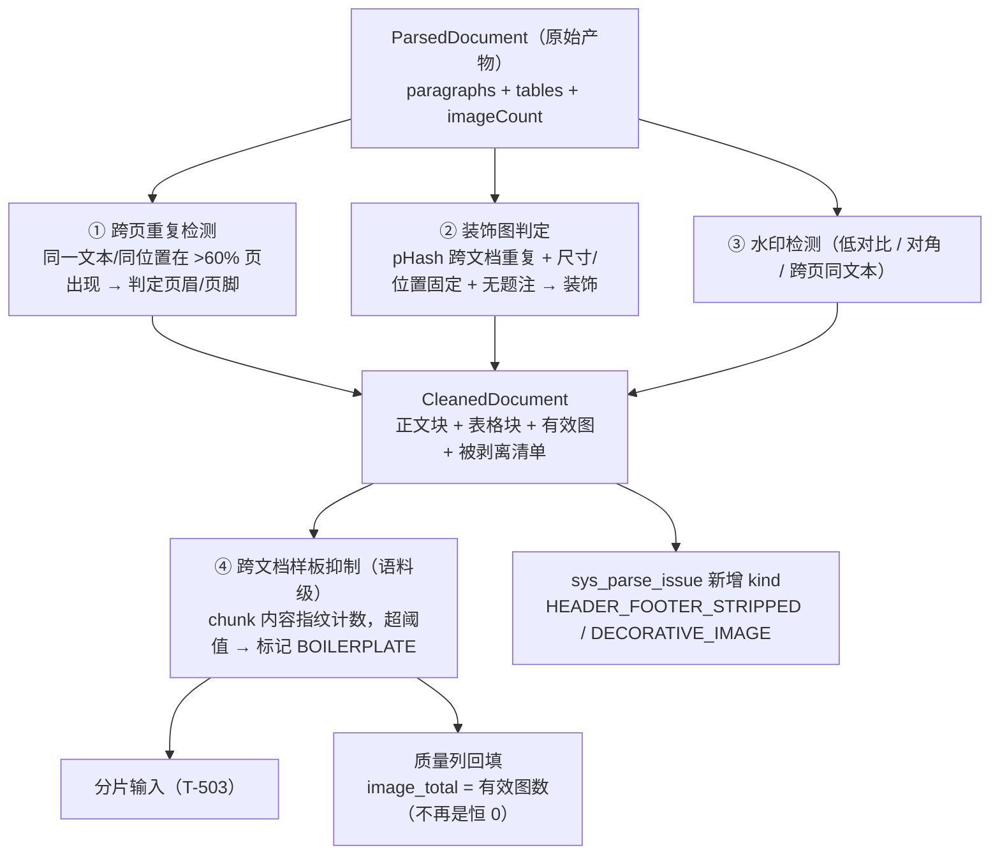

> 状态：⬜ 待认领 · 优先级 **P0** · 预估 4 人天 · 依赖：O1

# O3 · 噪音清洗层

## 1. 优化什么

在「解析产物」与「分片输入」之间，补一层**现在完全不存在**的清洗：
**页眉页脚剥离**、**装饰图识别**、**跨文档样板内容抑制**。

## 2. 痛点（现状实证）

现在唯一的"清洗"是剔 `1×1` 空表（`PdfDocumentParser` 的表格过滤，S4-B 判据 10）。`chars` 的注释说"不含图片/页眉/页脚"（`plan/汇总.md:266`）—— 但那是**统计口径**，**不是从产物里剥掉**。

后果比听起来严重：

| # | 噪音 | 为什么伤 |
|---|---|---|
| 1 | 页眉/页脚：`「XX公司 · 内部资料 · 第 N 页」` | ① 每页都进向量，稀释语义；② **逐页文本各不相同**（页码在变）→ 连"完全重复"都算不上，谁去重都去不掉；③ "内部资料"这类词变成超高频 token，在 BM25 侧直接污染打分 |
| 2 | 装饰图（logo / 背景 / 分隔线 / 装订线） | 现在**不识别、不过滤**；`image_total` 恒 0（`ParsedDocument#imageCount` **采了不写**）→ 前端对含图文档显示"无图片"，不准确 |
| 3 | 跨文档样板（免责声明、保密条款、公司简介、模板页） | 在几百个文档里各产生一份几乎相同的 chunk → **挤占 top-k、污染 RRF 融合**。这是"看起来召回了 20 条、其实 6 条是同一段废话"的典型成因 |
| 4 | 水印（页面对角文字） | 不处理，且**不在任何计划里** |

> 在传统 RAG 评测里，**页眉页脚是仅次于分片策略的第二大质量变量** —— 因为它无条件进入每一次嵌入。
> 而且这件事**必须在建向量之前做**：向量一旦生成，事后清洗等于全库重建。

## 3. 业务流程

## 4. 做法

| 步 | 做什么 | 依据 / 为什么 |
|---|---|---|
| 1 | **先查 opendataloader 是否已分类** header/footer | 它的 JSON 元素树有 `type` 字段（现用值：`heading/paragraph/list/table/image/caption`）。**若已有 `header`/`footer` 类型，直接用，不要自己写启发式** —— 这是一次探针就能确认的事，成本极低 |
| 2 | 没有则做**跨页重复检测**：把每页首/尾 N 行的文本归一化（去数字）后计数，>60% 页出现即判定为页眉页脚 | 归一化是为了让"第 3 页/第 17 页"归并成同一个模式；60% 是保守值（正文中重复的句子不会跨页到那种程度） |
| 3 | **装饰图判定**：跨文档 pHash 重复 + 尺寸/位置固定 + 无题注 | 公司 logo 永远在角落、永远同尺寸、永远没题注 —— 三个条件同时成立才判，避免误杀"每页都有但确是内容的图" |
| 4 | **`ParsedDocument#imageCount` 接进 `image_total`** | 已在采、只是没写。**成本几行，立刻消掉一处口径含糊**（S4-B §10-6 自己点的这条）。`image_parsed` 仍等 `T-512` 的 VL |
| 5 | **跨文档样板抑制**放在**分片之后、向量化之前**（属 `T-508` 的前置） | 它是**语料级**的（要看到多个文档才知道什么重复），单个文档的解析阶段做不了。这一步与 O9 同源，见 O9 |
| 6 | 被剥离的内容**不静默丢弃**：进 `sys_parse_issue`，`kind = HEADER_FOOTER_STRIPPED`（附"第 N 页起，共 M 处"） | 本项目口径：任何"少了一点东西"都要看得见。剥离是**处置**，不是**隐瞒** |

> **为什么清洗层与解析层分开**：解析器的职责是"忠实抽取"，清洗的职责是"判定什么是噪音"。混在一起会让解析器变成一个"各文档类型各有一套规则"的泥球，且**改清洗规则要重新解析**。分开后，清洗是对 `ParsedDocument` 的**纯函数变换**，可单测、可回放、可 A/B。

## 5. 验收判据

| # | 判据 | 方法 | 期望 |
|---|---|---|---|
| 1 | 页眉页脚被剥离 | 一份 20+ 页、带页眉页脚的 PDF（如 `江西省…项目管理章程.pdf`） | 产物文本中不含页眉页脚样板；issue 中有剥离记录 |
| 2 | 正文中的重复句**不被误剥离** | 同一份文档 | 正文内容完整，字数下降幅度与页数×页眉行数吻合 |
| 3 | 装饰图被识别 | 含 logo 的样本 | `image_total` < 原始 `imageCount`；issue 有对应记录 |
| 4 | 质量列不再是恒 0 | 含图文档 `GET /kb/{kbId}/docs` | `image_total > 0`；前端显示"有 N 张图（未理解）"而非"无图片" |
| 5 | 清洗是纯函数、可回放 | 同一 `ParsedDocument` 跑两次 | 输出逐字节一致 |
| 6 | 不回归既有判据 | 全量 `mvn test` | `DocParseFlowTest` 全绿（尤其 `table_total = 7` 这类硬数字） |

## 6. 不做 / 风险

| 项 | 说明 |
|---|---|
| ❌ 不做"用 LLM 判断哪段是噪音" | 不可复现、成本高、且**逐文档不确定性**会传染到检索质量。启发式 + 阈值可回放、可解释 |
| ❌ 不做水印去除（图像级 inpainting） | 代价远大于收益；本方案只做**文本型水印的检测与剥离** |
| ⚠️ 风险：**清洗会引入"语义断裂"** | 剥掉页眉页脚后，跨页句子可能被切断。本项目的对策是 **O8 的父子块 + 回表**（命中子块 → 取父块窗口），而不是"事后让 LLM 缝回去"（不可复现）。**清洗不做任何 LLM 补全** |
| ⚠️ 风险：阈值误杀 | 建议三个阈值都**做成配置**（而非常量），并在 `O5` 的基线上加"清洗前后 `chars` 比值"作为观察指标 —— 比值突变就是误杀信号 |
| ⚠️ 风险：跨文档样板抑制**有状态** | 它依赖"见过了多少文档"。冷启动期（前 100 篇）抑制不生效是正常的；不要在冷启动期把阈值调低 |
