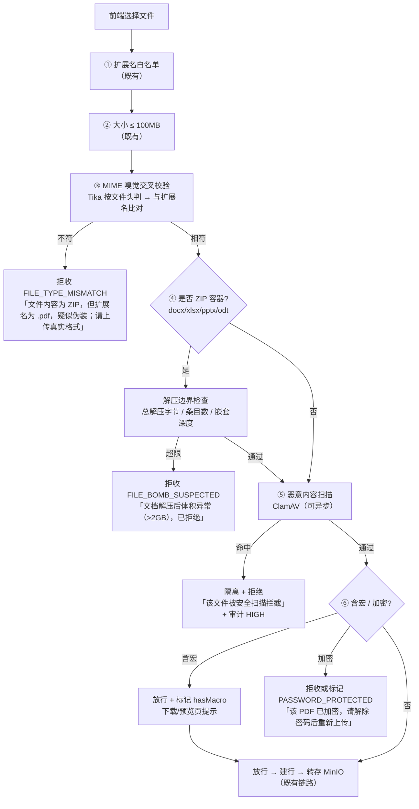

> 状态：⬜ 待认领 · 优先级 **P0** · 预估 3 人天 · 依赖：无

# O4 · 入库准入加固

## 1. 优化什么

把上传闸从「**白名单 + 大小**」补成企业级的「**白名单 + 大小 + 真实类型 + 解压边界 + 恶意扫描**」。
现有 `DocStorage#validate`（`DocStorage.java:213`）一条都不缺地保留了，本方案是**加**，不是改。

## 2. 痛点（现状实证）

现状四道闸：空文件（`10030`）· 100MB（`FILE_TOO_LARGE`）· 扩展名白名单 9 种（`FILE_TYPE_UNSUPPORTED`）· 对象名清洗（`safeName`）。

缺的五条，**每一条都有具体的失败场景**：

| # | 缺口 | 具体场景 | 为什么危险 |
|---|---|---|---|
| 1 | **无 MIME 交叉校验** | 把 `evil.zip` 改名成 `报告.pdf` 上传 | 现有实现是按**库里记的 `type`**（来自扩展名）分派解析器 —— 注释里写着"真正的防护在解析阶段（Tika 按文件头识别）"，**但代码没做**。结果是抛异常 → `FAILED`：安全上侥幸过关，但这是"恰好没出事"，不是"设计上挡住了" |
| 2 | **无 ZIP 炸弹限额** | `x.docx`（zip）解压后 4GB | 9 种格式里 **docx / xlsx / pptx 全是 ZIP 容器**，而 **100MB 上限完全不约束解压后的体积**（解压 10⁴ 倍是常见手法）。Tika 目前只被文件大小间接兜底 → 磁盘/内存被打满 |
| 3 | **无恶意内容扫描** | 宏病毒、包含内嵌可执行文件的 Office 文档 | 企业知识库收的是**不可信上传**。原始字节直接进 MinIO 并可通过预签名 URL 下发 —— 相当于把上传者给的文件原样转发给同事 |
| 4 | **宏格式无标记** | `.doc` / `.xls` 可带宏 | 解析不执行宏（安全），但**下载/预览会**。至少要能提示"此文档含宏" |
| 5 | **加密/受限件无区分** | 有密码 vs 允许打开但禁止复制文本 | 前者现在抛异常包成可读原因（可以）；后者**解析出空内容** → 落进 O2 描述的静默路径。两者必须**分开报**（一个要密码、一个要 OCR/转存） |

## 3. 业务流程

## 4. 做法

| 步 | 做什么 | 说明 |
|---|---|---|
| 1 | **MIME 交叉校验**：`Tika.detect(bytes, filename)` 取真实 MIME，与扩展名映射表比对，不符**直接拒收**（不是 `FAILED`） | 比"解析失败"**更准也更快**：用户当场知道是格式问题，不用等解析跑完。注意 .md 会被 Tika 报 `text/x-web-markdown`（S4-B §3.4 假设 2 已实测），映射表要写对 |
| 2 | **解压限额**：解压总字节 ≤ 1GB、条目数 ≤ 5000、嵌套 ≤ 3 层 | 与 100MB 输入上限的关系：**输入上限管"传输"，解压限额管"处理"**，两者不可互替。Tika 侧可通过 `SecureContentHandler`（压缩比阈值）+ 预扫 ZIP 中央目录两处落地 |
| 3 | **ClamAV**：docker-compose 加一个 `clamav` 服务，走 TCP 扫描；**未部署时降级为"跳过 + 标记"**，不阻断 | 企业级必查项。降级设计是为了不让本地开发被强制装 ClamAV —— 但要**在文档列表显示"未扫描"标记**，不能假装扫过了 |
| 4 | **宏 / 加密检测**：Tika 可直接给出 `hasMacro`；加密的 PDF/DOCX 在解析前就能判 | 加密文件**在准入阶段拦掉**比"建行后解析失败"干净（列表里不会出现一条假文档）—— 同 S4-B 判据 6 空文件的处置方式 |
| 5 | 新增错误码：`FILE_TYPE_MISMATCH` / `FILE_BOMB_SUSPECTED` / `FILE_MALICIOUS` / `FILE_ENCRYPTED`（**从 `10070` 起**，见下） | 现有 `FILE_TYPE_UNSUPPORTED(10034)` 是"不支持"，与"伪装/炸弹/恶意"语义不同，**不能复用**（本项目口径：白名单段与资源段分开，`ErrorCode.java:197,202`） |

> **错误码占用**：`10030~10039`（参数/文件）、`10040~10049`（资源）、`10050~10056`（认证）、`10065~10069`（组织）。
> 当前最大 `10069`。**本方案占用 `10070~10073`**，与 O1 的任务类码段无冲突（O1 不新增码）。

## 5. 验收判据

| # | 判据 | 方法 | 期望 |
|---|---|---|---|
| 1 | 伪装扩展名被拒 | 把 `.zip` 改名 `.pdf` 上传 | `FILE_TYPE_MISMATCH`；**不建行**（列表无假文档） |
| 2 | 正常 9 种格式全放行 | 每类各传一份真样本 | 全部通过准入（回归保护） |
| 3 | ZIP 炸弹被拦 | 造一个高压缩比 docx（解压 >2GB） | `FILE_BOMB_SUSPECTED`；**worker 内存不飙升** |
| 4 | 恶意样本被拦 | EICAR 测试串/virus 样本 | `FILE_MALICIOUS` + 审计 `HIGH` |
| 5 | 加密 PDF 的提示**不同于**扫描件 | 加密 PDF | 提到"加密/密码"，**不是**"未提取到可复制文本"（两者语义不同，混在一起用户无从下手） |
| 6 | 未部署 ClamAV 时行为明确 | 停掉 clamav 容器 | 上传成功但列表显示"未扫描"标记（**不是**静默当作已扫描） |
| 7 | `.md` 不被误拒 | 6 份 MD 样本 | 全放行（Tika 报 `text/x-web-markdown`，映射表必须覆盖） |

## 6. 不做 / 风险

| 项 | 说明 |
|---|---|
| ❌ 不做内容级敏感信息检测（DLP） | 那是运营/合规模块的题目，且需要与密级策略联动，不在入库闸的职责内 |
| ❌ 不做沙箱解析 | Tika/opendataloader 都是纯读取库，不执行宏；沙箱是"解析器有 RCE 风险"时才需要的，目前不成立 |
| ⚠️ 风险：MIME 交叉校验会**误拒** | 有些工具生成的 docx 文件头不规范。对策：**只对"明显不符"（如 zip vs pdf、image vs office）拒收**，对"模糊"（octet-stream）放行并记录 —— 误拒比误放更伤用户 |
| ⚠️ 风险：ClamAV 常驻内存约 1GB | 本地开发机的 docker 已经是 6 服务；加它前先确认机器余量，或默认走"未部署降级"路径 |
| ⚠️ 与 O1 的关系 | 恶意扫描**不应阻塞上传响应**（用户等的是受理确认）。建议：准入闸里做**同步的**大小/类型/炸弹检查（都是轻量的头部解析），ClamAV 放**异步**（进 O1 的 worker 队列），扫描未过则把文档置为 `FAILED` + 可执行原因 |
