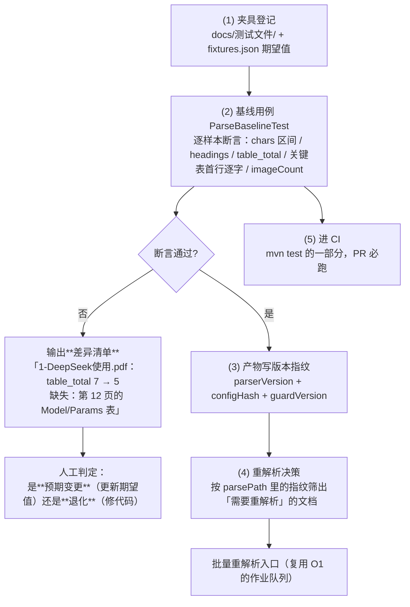

> 状态：✅ **已完成**（`S5-M07-B`，2026-09-17）—— **步 1~8 全交 · 判据 1~6 全通过**
> 优先级 **P1** · 实际 3 人天 · 依赖：O1 ✅
> 计划与验收：`ai_knowledge_web/plan/2026-09-17-S5-M07-B.md`
>
> **两处与本方案原设计的偏差（照实记录，不抹平）**：
> ① **判据 2（本方案自称"最重要的验证项"）的第一版基线抓不到它要抓的东西** ——
>    注入 `keepLineBreaks=false` 后 17 个样本**全绿**，因为 §4 步 1 选的度量
>    （`chars` 区间 / `tableTotal` / 首表头锚点）对"多行单元格被压平"**都不敏感**。
>    加了一条直指该红线的度量（跨表**含换行的单元格数**，`18→4` / `53→22`）之后才抓住。
>    **那条度量是被证伪逼出来的，不是设计时想到的** —— 已写进 `ParseBaselineTest#multiLineCells` 的 javadoc。
> ② **步 6 只交了服务，没交 HTTP 接口** —— 消费方页面（原型 20）属 S8 的 M10，
>    且 `PermissionCode` 里没有 `ops:*`。**判据 6 不依赖 HTTP 层**，已用"聚合 vs 直查 SQL 逐项吻合"完整验证。
>    另外「平均 `chars/页`」原先**没有数据来源**（`chars` 在 `parse.json` 里），本批补了 `V21` 的 `sys_document.chars`。
> ③ 「解析耗时 P95」**刻意不产出** —— 拿 `sys_async_task` 的 `finished_at - created_at` 当"解析耗时"
>    是**把任务耗时说成解析耗时**（转存/分片/向量化都在里面），一个不会被发现的口径错。

# O5 · 解析质量基线与可追溯

## 1. 优化什么

把 `docs/测试文件/` 从**人工看的样本**升级成**进 CI 的结构化夹具 + 断言**；
并给解析产物写入**版本指纹**，让"改了解析器/升了依赖之后，哪些文档需要重解析"从"靠猜"变成"查得到"。

## 2. 痛点（现状实证）

**企业知识库里，解析质量事故 90% 是静默的** —— 不是崩，是"少了一点东西"，而没人会发现。本项目已经踩到过两次同形状的坑：

| 已发生的 | 形态 | 当时的发现方式 |
|---|---|---|
| `opendataloader 1.11.0` → `NoSuchMethodError` | 跑不起来 | 侥幸：spike 期就跑到了（`T-0S1` §四） |
| `commons-compress` 1.24.0 vs Tika 3.2.2 | 跑不起来（**任何 DOCX/XLSX 都崩**） | 侥幸：S4-B 接入时就崩了（S4-B §1-10） |
| （尚未发生但必然会发生） | **跑起来了但输出变了**：升级 Tika 后某类表少识别 2 张、改了 `keepLineBreaks` 后多行单元格被压平 | **没有任何机制能发现它** |

现状的具体缺口：

- `docs/测试文件/` 有 5 PDF / 4 DOCX / 1 XLSX / 6 MD / 1 TXT，且**已经全部被探针跑过一遍**（S4-B §1 样本表）—— 但那份结论是**抄进计划文档里的数字**，不是**可执行的断言**。
- 测试里已有硬数字（`table_total = 7`、`chars = 2149`），但**藏在单个用例里**，没有形成"改任何解析相关代码 → 跑一遍 → 看差异清单"的工作流。
- `parse.json` **无版本信息**：产物是定名覆盖写（`parsed/{kbId}/{docId}/parse.json`），既不知道是用哪个解析器版本产的，也不知道是哪个 `TextLayerGuard` 阈值判的。

> **本方案是整个优化集里性价比最高的一个**：它不产生任何新功能，但它是**其他所有优化敢做的前提** —— 没有基线，O2 的阈值调整、O3 的清洗规则、O4 的 Tika 调用都是"改完不知道有没有变坏"。

## 3. 业务流程

## 4. 做法

| 步 | 做什么 | 说明 |
|---|---|---|
| 1 | **夹具登记表** `src/test/resources/parse-fixtures.json`：样本文件名 → 期望（`charsMin`/`charsMax`、`headingsMin`、`tableTotal`、`imageCount`、若干"关键单元格逐字"锚点） | 用**区间**而非等值（`chars` 会随清洗规则微调，见 O3）；但**结构事实用等值**（表数、标题层级数、关键单元格文本）—— 那才是质量的红线 |
| 2 | `ParseBaselineTest`：逐样本跑真实解析并断言；失败时**打印差异清单**而不是只报 assert 失败 | 差异清单是这个用例存在的意义 —— 它要替人回答"到底变了什么" |
| 3 | **产物版本指纹**：`parse.json` 增加 `meta`（`parserVersion`、`parserConfigHash`、`guardVersion`、`cleaningVersion`） | `parserVersion` = opendataloader + Tika 的版本；`configHash` = `Config` 各开关序列化后的哈希。**判据：任何一项变了，都意味着"旧产物可能不反映当前逻辑"** |
| 4 | `sys_document` 增加 `parse_version VARCHAR(64)`（**与 `parse_path` 并列**），从产物 meta 回填 | 让"筛出需重解析的文档"变成一条 SQL，而不是遍历 MinIO 读 JSON |
| 5 | **重解析入口**：复用 O1 的作业队列，支持按 `kbId` / 按 `parse_version` 差异批量投递 | 这是 `T-406`（重建索引）的解析侧前置。**注意幂等**：重跑覆盖旧产物（`DocStorage#storeArtifact` 已是覆盖写，S4-B 已保证 issue 先删后插） |
| 6 | **聚合质量指标进看板**（接原型 `20-检索质量分析` 页）：解析成功率、平均 `chars/页`、表格识别率、`pagesWithText/pagesTotal`、耗时 P95，**按格式 / 按库 / 按原因分布** | `sys_parse_issue` 是行级明细，缺**聚合**。企业运维要的是分布，不是 2000 行明细 |

> **为什么用"关键单元格逐字"而不是"整篇哈希"**：整篇哈希对任何无关改动都敏感（改个换行就红），会导致"狼来了"而被人关掉。锚点式断言只盯**质量红线**：这张表还在不在、表头还是不是那几列、多行单元格有没有被压平。

## 5. 验收判据

| # | 判据 | 方法 | 期望 |
|---|---|---|---|
| 1 | 基线覆盖全部样本 | `mvn test -Dtest=ParseBaselineTest` | 5 PDF + 4 DOCX + 1 XLSX + 6 MD + 1 TXT 逐个断言 |
| 2 | **故意注入退化能被抓到** | 临时把 `keepLineBreaks` 改成 `false` 跑基线 | 用例红，差异清单指出"多行单元格被压平"（**这是本方案最重要的验证项**：证明基线真能发现静默退化） |
| 3 | 差异清单可读 | 同上 | 输出为"样本 → 字段 → 旧值 → 新值 → 受影响的具体位置"，不是一行 `expected: <7> but was: <5>` |
| 4 | 版本指纹真实可筛 | 查库：`select parse_version, count(*) from sys_document group by 1` | 升级解析器后能一眼看出哪些文档是旧版本产的 |
| 5 | 重解析幂等 | 对同一文档连续重解析 2 次 | `parse_path` 不变、`sys_parse_issue` 不翻倍（S4-B 判据 16 的既有保证不回归） |
| 6 | 看板指标与库内真值一致 | 对比聚合接口与 `sys_parse_issue` 直查 | 逐项吻合，无"仪表盘好看、真相不同"的漂移 |

## 6. 不做 / 风险

| 项 | 说明 |
|---|---|
| ❌ 不做"解析准确率"的自动评分 | 那需要人工标注的 golden set（谁是对的？），成本远超收益。本方案的基线只断言**结构事实**，不断言"抽得准不准" |
| ❌ 不把样本文件入库（`docs/测试文件/` 是 gitignored） | 现状如此（S4-B §1 第 9 条）。**风险**：CI 机器上没样本 → 基线自动跳过。**对策**：用例在缺样本时 **失败而非跳过**（`Assumptions` 会静默假绿），或把样本放入独立 artifact 仓库 |
| ⚠️ 风险：期望值会**腐烂** | 每次"预期变更"都要更新期望值，久而久之没人敢改。对策：差异清单里带**"本次改动声称做了什么"**（PR 描述）供人工对照；期望值更新**必须进提交记录**，可追溯 |
| ⚠️ 风险：`chars` 区间在 O3 清洗落地后会整体下移 | **这是预期内的**：O3 落地那批必须**同时**更新基线并说明下降幅度与页数×页眉行数的对应关系 —— 这正好是验证 O3 没误杀的量化依据 |
| ⚠️ 依赖：`docs/测试文件/` 里**没有报价单、没有带表格的扫描件**（S4-B §1 W7） | 这两类正是 `T-504`/`T-505` 表格双表示判据要用的样本。基线落地时一并补齐（该缺口已挂在 `plan/汇总.md`） |
