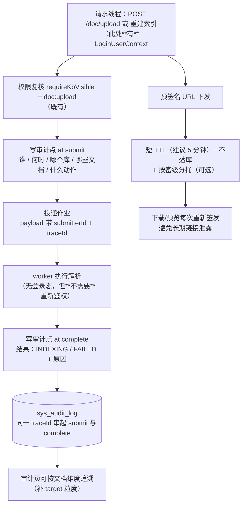

> 状态：🟡 **部分已交付**（`S4-E2`，2026-09-17）· 优先级 **P1** · 预估 1.5 人天 · 依赖：O1 ✅
>
> ✅ **步 1/3 已交付**：三条审计点（触发解析 / 解析完成 / 解析失败），提交记在**请求线程**（操作人 = 上传者）、
> 完成记在 **worker**（`system`/「系统」），两条**同 traceId**；`AuditAspect` 新增 `#result` SpEL 变量，
> 两条审计的 `target` 都由「知识库#N」细化到「文档#N」。
> ✅ **步 2 早在 `S4-E1` 就已落好**（`sys_async_task.owner_id`/`trace_id` 两列）。
> ✅ **步 6 已由 `S4-D` 的 `T-O07` 交付**（存储生命周期规则表）；**步 5「按密级分桶」本方案自己判 ❌ 不做**。
> ⏸️ **步 4「预签名 TTL 收窄」挂起** + **判据 3「重跑可追溯」挂起** —— 两者依赖的
> `GET /doc/download-url/{docId}` 与 `POST /doc/{docId}/reindex` **后端根本没有实现**（属 `T-614`/S7）。
> ⚠️ **`T-614` 立据时请把这两条判据抄进它的 §6+7**，否则挂起会变成静默丢失。
> ⚠️ **本方案 §6 最后那条风险「审计模型要能表达系统动作」已查清 —— 不需要迁移**：
> `V1__init_skeleton_schema.sql` 里 `operator`/`operator_name` 本就**可空**，故只需在采集侧表达（`AuditEvent.SYSTEM_OPERATOR`）。

# O6 · 审计与合规留痕

## 1. 优化什么

让**解析这件事有痕**：谁在什么时候触发了哪篇文档的解析、结果如何、被谁重跑过。
同时把预签名 URL 的暴露面收窄（密级/权限在 MinIO 那层**不存在**）。

## 2. 痛点（现状实证）

| # | 现状 | 后果 |
|---|---|---|
| 1 | 解析在 **`ak-task-*` 工作线程**跑，`LoginUserContext` / `AuditContext` **不跨线程** → **不打审计点、不复核权限**（`DocParseService` 类注释 + `plan/2026-09-16-S4-M05-B.md` §3.4 假设 6） | 企业审计必问「**谁在什么时候触发了 X 的解析**」—— 答案查不到。现在只能查到"上传"这一个动作，查不到"解析""重解析" |
| 2 | 上传的审计点是 `@AuditLog(module = DOC, action = "上传文档", target = "'知识库#' + #kbId")`（`DocService.java:148`） | **粒度到库，不到文档** —— 出问题时无法回答"这个人动过哪些文档" |
| 3 | 预签名 URL 绕过应用层 ACL | 这是**刻意的设计**（`11-非功能需求.md:153`：文件不流经应用服务器）。但它的代价是：**密级/知识库权限在 MinIO 那层不存在**，URL 一泄露就穿透 |
| 4 | `T-616` 删除文档时"删了什么"没有规则（`DocStorage#remove` **当前无调用方**，`DocStorage.java:183`） | 合规必问：删文档到底删了源文件、解析产物、还是向量？ |

> **本方案的立场**：不是"加一个日志"，而是把**权限决策点前移到提交时**（那时有登录态），
> 让工作线程只执行**已经被授权过的**既定作业 —— 这比"让 `LoginContext` 跨线程"干净得多。

## 3. 业务流程

## 4. 做法

| 步 | 做什么 | 说明 |
|---|---|---|
| 1 | **提交时补审计点**：`action = "触发解析"` / `"重跑解析"`，`target` 从 `'知识库#' + #kbId` 细化到**文档级**（`'文档#' + #docId`） | 不动工作线程 —— 审计发生在**有登录态的那一刻**，这是本方案的核心取舍 |
| 2 | **作业 payload 带 `submitterId` + `traceId`** | 与 O1 的 `sys_async_task` 天然合流：那张表本来就要存 `owner_id` / `trace_id` |
| 3 | **完成时补审计点**（`action = "解析完成"` / `"解析失败"`，含原因），用**同一 traceId** | 让"提交 → 结果"在审计页串成一条。注意：这是**系统动作**（无 operator），要在审计模型里能表达"系统" |
| 4 | **预签名 URL 收窄**：TTL 从当前值降到 **5 分钟**；**不落库**（不进 `sys_document` 等表，只在响应里给）；下载/预览每次重新签发 | 现状已遵守"存对象名不存 URL"（`DocStorage` 类注释明确"存事实，不存视图"）—— 本步是把这个好习惯**落实到 TTL 与刷新策略**上 |
| 5 | **按密级分桶（可选，需评估）** | 若密级差异大（公开资料 vs 内部机密），按密级分 bucket 并在 bucket 策略上做隔离，是唯一能让"MinIO 那层也有权限"的低成本做法。**成本**：`storage_path` 迁移 + 预签名逻辑分流 |
| 6 | **删除清理规则表**（与 O7 合流）：源文件 / 解析产物 / 向量 / 审计日志 四类，各自"随文档删除 / 保留 N 天 / 永久保留" | `DocStorage#remove` 至今**无调用方**。规则定下来才有 `T-616` 的实现依据 |

> **为什么不让 `LoginContext` 跨线程**：那是一处**全局性**改动（`汇总.md` §3 #5 是既有取舍，S3 就已登记），
> 影响所有异步任务；而"审计打在提交点"的成本是**局部**的，且语义更正确 —— **授权决策本来就该发生在有身份的时候**。

## 5. 验收判据

| # | 判据 | 方法 | 期望 |
|---|---|---|---|
| 1 | 解析有痕 | 上传一份文档后查审计页 | 出现"触发解析"记录，操作人 = 上传者，目标 = 具体文档 |
| 2 | 结果有痕 | 同上，等解析完成 | 出现"解析完成/失败"记录，**与提交记录同 traceId** |
| 3 | 重跑可追溯 | 直调 2 次重解析 | 两条"重跑解析"记录，可看出谁跑的、跑了几次 |
| 4 | 无登录态的工作线程**不产生假记录** | 检查失败/完成记录的 operator 字段 | 显示为"系统"而非"未知用户"或空 |
| 5 | 预签名 TTL 生效 | 取一个 URL，等 6 分钟再访问 | 失效（403）；且 URL **不在任何表里**（`select` 验证） |
| 6 | 审计页可按文档维度筛 | 按 `target = 文档#N` 查 | 返回该文档的完整生命周期（上传 → 解析 → 结果 → 重跑） |

## 6. 不做 / 风险

| 项 | 说明 |
|---|---|
| ❌ 不做"解析内容的完整快照审计"（把产物全文存审计） | 审计记的是**动作与结果**，不是内容副本；内容副本是存储的职责 |
| ❌ 不改 `LoginUserContext` 的跨线程能力 | 见上，权衡后不划算 |
| ⚠️ 风险：审计量增长 | 每次重解析都是 2 条（提交 + 完成），批量导入 5000 篇 = 1 万条。**对策**：批量导入走"批次级"审计点（一条记录 + 文档计数），不逐篇记 |
| ⚠️ 风险：按密级分桶是**不可逆**的迁移 | `storage_path` 变了要动全部历史数据。建议**先只做 TTL 收窄 + 不落库**（零成本、可回滚），分桶留到有明确合规要求时再做 |
| ⚠️ 依赖：审计模型要能表达"系统动作" | 若 `sys_audit_log` 的 `operator` 是 NOT NULL 且无系统语义，需要一次小迁移（加 `operator_type` 或允许固定值 `SYSTEM`）。**先查清再动**，这是本方案唯一可能的表结构变更点 |
