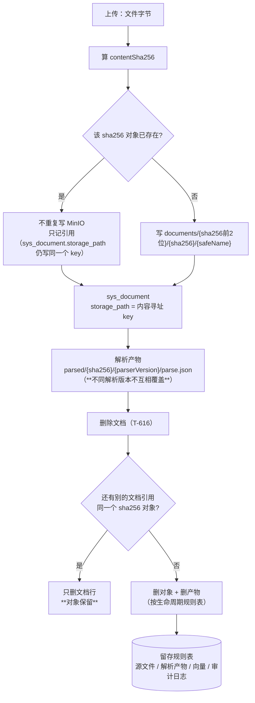

> 状态：⬜ 待认领 · 优先级 **P1** · 预估 2 人天 · 依赖：无

# O7 · 存储寻址与生命周期

## 1. 优化什么

对象存储从**按 id 寻址**改为**内容寻址**（`sha256`），并把"删文档到底删了什么"从**未定义**变成**一张明文的规则表**。

## 2. 痛点（现状实证）

### 2.1 寻址方式

现在是 `documents/{kbId}/{docId}/{safeName}`（`DocStorage.java:88`），解析产物 `parsed/{kbId}/{docId}/{name}`（`DocStorage.java:166`）。

这个设计的**优点**写得很好（`DocStorage` 类注释：带 `kbId` 便于按库前缀删除、带 `docId` 删除后对象可定位、带 `safeName` 运维看得懂、**不去中文**）—— 这些都要保留。

它缺的是：**同一份字节被传到 10 个知识库，就真的有 10 份对象**。

| 场景 | 现状 |
|---|---|
| 同一份员工手册传到 8 个库 | MinIO 里 **8 份完全相同的字节** |
| 同一份文件被同一人在两个库各传一次 | 2 份（去重键 `(kb_id, owner_id, md5)` 允许） |
| 100MB 的规范文档被 5 个部门各传一份 | 500MB 存储换 0 信息 |

企业场景里"同一份文件多库共享"是**常态**而不是例外（制度文件、规范、模板）。

### 2.2 生命周期

| 事实 | 来源 |
|---|---|
| `DocStorage#remove` **当前无调用方** | `DocStorage.java:183`（"T-616 起接入"） |
| `parsed/` 与源文件的删除策略**没耦上** | `plan/2026-09-16-S4-M05-B.md` §9-9（归 S7） |
| 三个前缀（`documents/` / `parsed/` / 审计导出）**没有留存规则** | 无任何文档定义 |

> 企业知识库上线后一定会被问："**删这篇文档，到底删了什么？**"现在这个问题的答案**在代码与文档里都不存在**。

## 3. 业务流程

## 4. 做法

| 步 | 做什么 | 说明 |
|---|---|---|
| 1 | **内容寻址 key**：`documents/{sha256[0:2]}/{sha256}/{safeName}` | 保留 `safeName`（运维可读，这是现有设计的优点）；两级分片（前 2 位）避免单目录对象过多。**带 `sha256` 的好处**：对象**不可变**（同 key 必同内容）→ 可安全用 `Cache-Control: immutable`、可做 CDN、重传不会覆盖出问题 |
| 2 | **不丢 `kbId` 的可追溯性**：`kbId`/`docId` 的位置信息**全在 `sys_document` 行里**（`storage_path` + `kb_id`），不再进对象名 | 现有设计把 `kbId` 放对象名是为了"按库前缀删除"—— 有了内容寻址后，这个需求由**引用计数 + 库查询**满足，不需要靠对象名 |
| 3 | **上传时先 stat**：`sha256` 已存在则不重复 PUT | MinIO 的 `putObject` 本身是覆盖写，但**跳过上传**能省掉整条网络传输。这是"秒传"的真正实现（现在 `check-md5` 只做**提示**，不省传输） |
| 4 | **解析产物按版本隔离**：`parsed/{sha256}/{parserVersion}/parse.json` | 与 O5 的版本指纹天然合流：**旧产物不删、新版本另存**，重解析出问题时可以回退对比。**代价**：产物占多份，但产物是 JSON（远小于源文件），且可只保留最近 2 个版本 |
| 5 | **留存规则表**（写进文档，`T-616` 按它实现） | 四类对象各自定：① 源文件 —— 随文档删除，**引用计数归零才真删**；② 解析产物 —— 随源文件删除，或保留 30 天供排障；③ 向量 —— 随文档删除（`T-616` 已有条件）；④ 审计日志 —— **永久保留**（合规要求，且不含内容） |
| 6 | **引用计数**：`sys_content_blob(sha256 PK, size_bytes, ref_count, created_at)` | `ref_count` 在文档插入/删除时增减。**并发注意**：用 `update ... set ref_count = ref_count ± 1` 的原子形式，不要读改写 |

> **为什么现在做**：这是一个**寻址方式**的变更 —— 越晚做，需要迁移的历史数据越多（现在库里文档行很少）。等到有几百万对象再改，就是一次带停机的大迁移。
> **迁移方式**：不需要一次性搬历史对象。新上传走新规则，历史对象**继续可读**（`storage_path` 存的是完整 key，两种形态都能被 `open()` 读回来）—— **零停机、渐进切换**。

## 5. 验收判据

| # | 判据 | 方法 | 期望 |
|---|---|---|---|
| 1 | 同字节多库上传只存一份 | 同一文件传 3 个库，查 MinIO | 对象数 = 1；3 条 `sys_document` 行的 `storage_path` 相同 |
| 2 | 第二、三次上传**不产生网络传输** | 上传接口耗时 | 显著低于首次（跳过 PUT） |
| 3 | 删除一个库的文档**不影响**另一个库 | 删其中 1 条引用后读另外 2 条 | 另外 2 条仍可正常读回（对象未删） |
| 4 | 引用计数归零才真删 | 删掉全部 3 条引用 | 对象被删（`sizeOf` 返回 `-1`） |
| 5 | 历史对象仍可读（渐进迁移） | 用旧形态 key 的文档 | `open()` 正常（**不允许出现"升级后老文档读不出来"**） |
| 6 | 解析产物按版本隔离 | 改 `parserVersion` 后重解析同一文档 | 两个产物对象共存；`parse_path` 指向新的 |
| 7 | 生命周期规则表已入库 | 查文档 | 四类对象的规则逐条写明，`T-616` 可直接照着实现 |

## 6. 不做 / 风险

| 项 | 说明 |
|---|---|
| ❌ 不做跨区域的存储分层（冷热） | MinIO 的生命周期规则足以表达"30 天后转冷"，不需要应用层参与 |
| ❌ 不做对象级加密 | 与现有架构不一致（无 KMS），且 `11` §5 的安全条款未要求 |
| ⚠️ 风险：**引用计数是分布式一致性的经典坑** | 只用原子 `update`，不做读改写；删除操作走**同一事务**并接受"极小概率的泄漏对象"（宁可漏删，不可误删 —— 误删是不可恢复的） |
| ⚠️ 风险：`storage_path` 里出现两种 key 形态 | 这是**渐进迁移的必然**。`open()` 只接受库内写的值（既有的安全设计），所以两种形态都合法。**要写清注释**，否则后来者会以为数据脏了 |
| ⚠️ 风险：内容寻址让"按库删除"变复杂 | 现在的"按前缀删除"（一个 `rm --recursive` 解决）不再可用。**这是本方案的主要代价** —— 换来的是存储去重与对象不可变性。若产品更看重"删库要快且干净"，则**本方案应降级**（只做生命周期规则表那半），需与产品确认优先级 |
