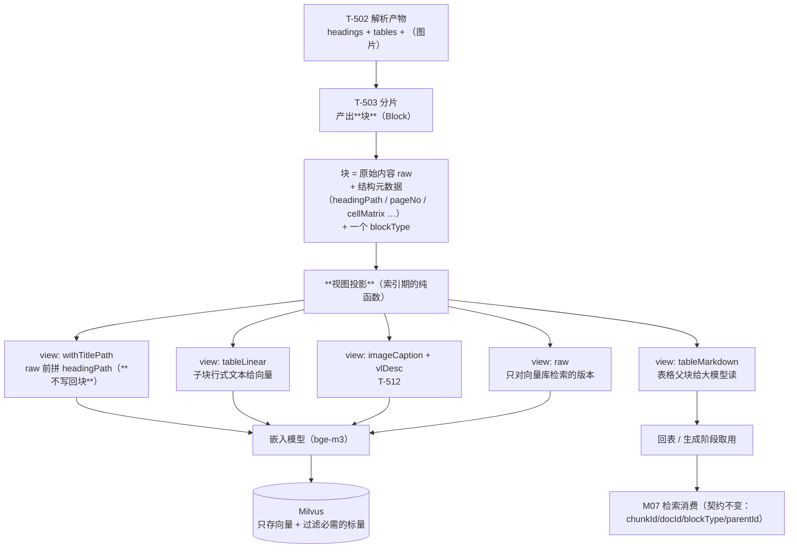

> 状态：⬜ 待认领 · 优先级 **P0** · 预估 3 人天 · 依赖：无（**但必须在 `T-503` 开工前定案**）

# O8 · 分片契约：块与视图分离

## 1. 优化什么

把「**块是什么**」与「**喂给嵌入模型什么**」拆成两层：
块持有**原始内容 + 结构化元数据**，而"给嵌入的文本"是**索引期的一个可切换投影**（view）。

顺带把「表格双表示」从一个**特例**泛化成通用能力。

## 2. 痛点（现状实证）

### 2.1 「标题路径注入」被定义成**就地改造内容**

契约 `docs/后端开发文档/10-M05-分片产出契约（D-5）.md` §1.1 与 `07-需求-检索与问答.md:411`：

| 说法 | 出处 |
|---|---|
| 「把 `3. 接口设计 > 3.1 鉴权流程` **拼进分片内容**再索引」 | `07` §附（标题路径注入） |
| 「**原地改造原分片**（不新增块）」 | `07` §附（产出块列） |
| `titlePath` 作为字段"标题路径……索引增强阶段的产物" | D-5 §1.1 |

问题在于**"拼进内容"是不可逆的**：

| 后果 | 说明 |
|---|---|
| 想改注入策略（不注了 / 换分隔符 / 只注一层）→ **必须重解析全库** | 因为内容已经变了，原始块不存在了 |
| 注入后的文本**无法回收**：回表给大模型的是拼接过的版本，不是作者写的那段 | 表格父块"给大模型读"的语义被污染 |
| **A/B 无法做**：`08-需求-运营分析.md:222` 明确说"建议把**每个检索增强项**都做类似的 A/B 验证，用数据决定去留" —— 而"拼进内容"的设计让 A/B 变成"两套索引"，成本高到不会有人做 |

### 2.2 表格双表示是特例，而不是通用能力

D-5 §1.4 把"两份内容"写成了**表格专属**规则：父块存 Markdown、子块存行式文本。

但**同一形状的需求有四个**：

| 对象 | 给大模型读的那份 | 给向量检索的那份 |
|---|---|---|
| 表格 | Markdown 管道表 | 行式文本（列名 + 值） |
| 图片（`T-512`） | 原图 | VL 描述文本 |
| 正文块 | 原文 + 标题路径 | 原文 + 标题路径（或只原文） |
| HyQ（`T-507`） | —— | 假设问句 |

四个需求、四套写法，**每一套都要在 `T-503`~`T-512` 里各实现一遍**。

## 3. 业务流程

## 4. 做法

| 步 | 做什么 | 说明 |
|---|---|---|
| 1 | **契约增补**（改 D-5 §1.1）：块表增加 ① `rawContent`（**原始内容，永不改写**）② `viewConfig` 概念（**不属于块**，属索引期配置） | `rawContent` 是"事实"，视图是"投影"。这与项目既有口径完全一致 —— `DocStorage` 类注释那句「**存事实，不存视图**」在这里同样成立 |
| 2 | **`titlePath` 从"拼进内容"改为"独立字段 + 索引期投影"** | `titlePath` 字段本来就在 D-5 §1.1 里（有 Milvus 标量 `title_path`）。改为：**块存 `titlePath`，嵌入文本 = `titlePath + 分隔符 + rawContent`**（拼接发生在送给嵌入模型之前的最后一刻） |
| 3 | **视图枚举** `ChunkView { RAW, WITH_TITLE_PATH, TABLE_MARKDOWN, TABLE_LINEAR, IMAGE_DESC }`，每个块类型声明"我的视图有哪些" | 表格：`TABLE_MARKDOWN`（父块，给生成）+ `TABLE_LINEAR`（子块，给向量）；正文：`RAW` + `WITH_TITLE_PATH`。**泛化点在这里**：新增块类型 = 声明视图，**不改管线** |
| 4 | **视图决定"谁进向量"**（写入 Milvus 前的一次投影） | 现在"父块不参与检索、子块参与"这条规则（D-5 §1.4）成为**视图的默认配置**，而不是硬编码在表格分支里 |
| 5 | **`viewConfig` 做成库级配置**（与现有解析配置同层，`06` §3.4 的"索引增强"栏） | `06-需求-知识库与文档.md:402` 已经有「标题路径注入 / HyQ / 文档级摘要 / 内容标签抽取」四个开关。本方案让它们真正成为**开关**（改开关 = 重建索引，不需要重解析） |
| 6 | **A/B 变成可行**：同一批块用两个 `viewConfig` 各建一份向量到不同 collection，跑同一批查询对比 | 这才是 `08` §222 说的"用数据决定去留"的落地形态 |

> **本方案改动量很小，收益极大**：本质是**把一次字符串拼接从"写库时"挪到"送嵌入前"**。
> 但它决定了 `T-503`~`T-512` 是"五个特例"还是"一个机制 + 五个配置"。
> **越早改越便宜**：`T-503` 还没开工，`sys_chunk`（`V14`）还没落 —— **现在改是改文档，S4-C 之后改是改数据模型 + 重解析全库**。

## 5. 验收判据

| # | 判据 | 方法 | 期望 |
|---|---|---|---|
| 1 | 契约文档已更新 | 检查 D-5 §1.1 / §1.4 | `rawContent` 与视图概念写明；`parentId`/`blockType` **口径不变**（这是硬要求，勿改回） |
| 2 | 块内容**不因注入而改变** | 建索引后读 `sys_chunk.raw_content` | 与解析产物逐字一致；不含标题路径前缀 |
| 3 | 嵌入文本**含**标题路径 | 同一块的两个视图分别投影 | `WITH_TITLE_PATH` 含前缀；`RAW` 不含 |
| 4 | 切换视图**不需要重解析** | 关闭"标题路径注入"后重建索引 | 只跑向量化，**不触发 `parseDocument`** |
| 5 | 表格规则等价 | 表格父子块的视图配置 | 与 D-5 §1.4 现有规则**逐条等价**（父块 Markdown 不进检索、子块行式文本进检索）—— **本次是重构，不是行为变更** |
| 6 | 图片视图预留可插 | `T-512` 未做时 | `IMAGE_DESC` 视图存在但无实现；`T-512` 落地时**只加实现，不改管线** |
| 7 | M07 消费侧零改动 | 对照 D-5 与 `T-700`/`T-705` | 消费字段（`chunkId`/`docId`/`blockType`/`parentId`/`titlePath`）**一个没变** |

## 6. 不做 / 风险

| 项 | 说明 |
|---|---|
| ❌ 不改 `parentId` / `blockType` / `chunk_type` 任何既有口径 | D-5 §1.2 明确标了「**勿改回**」，本方案一个字都不动 |
| ❌ 不做 chunk 级摘要 | `02-需求总览与分档.md` §2 边界已定"只做文档级" |
| ❌ 不引入语义切分 | `T-503` 已定"仅'无标题且超长'兜底且不可配置" |
| ⚠️ 风险：**视图与 Milvus 标量的关系** | `titlePath` 既是块字段（Milvus 标量 `title_path`）又是视图输入。**要写清**：它进标量是为**过滤**，进嵌入是为**语义**，两件事互不替代（I-9 口径：标签不进 Milvus —— 注意 `titlePath` 不是标签，是结构信息） |
| ⚠️ 风险：多视图会让 `sys_chunk` 的行数**分离** | 需要明确：**一行为一个块，视图不进表**（视图是运行时投影）。若将来要持久化视图（比如为了排查"到底是哪份文本进了向量"），再另开表，**不要往 `sys_chunk` 里塞多行** —— 那会破坏"一行为一块"的父子关系 |
| ⚠️ 依赖：须与 `V14`（`sys_chunk`）的落地批次**同批修改契约** | 该表尚未落（S4-B §9-1：`V14` 顺延给 `sys_chunk`），是最好的时机 |
