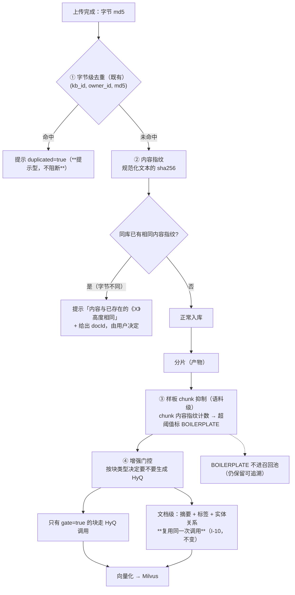

> 状态：✅ **已结项（`S5-M08-B`，2026-09-18）** —— 步 1/2/3/4/7 于 `S5-M07-A` 交付（判据 1/2/3/4/7 全通过）；
> **步 5（HyQ 门控）+ 步 6（章节级摘要）本批交付**（`HyqGate` 纯函数门控 + 复用同一次文档级调用产出每章一条 `SUMMARY`）。
> ⚠️ **步 5 有个前置坑**：它要门控的 **HyQ 生成当时根本不存在**（`HYPOTHESIS_QA` 全仓仅是枚举常量，无任何生成代码）
> ⇒ 判据「开/关门控各建一次索引 → LLM 调用量显著下降」**无对象可测**。
> 故本批**先补 `T-507` 的 HyQ 半边**再门控（用户 2026-09-18 裁定，见 `plan/2026-09-18-S5-M08-B.md` §1 #4）。
> ⚠️ **判据 5 只有一半**：`LLM 调用量下降` ✅ 已量（替身计数）；**`召回质量不显著劣化` ⏸️ 挂起**
> —— 那要真模型跑 A/B，与 `mvn test`「全替身无网络」硬口径冲突。
> **阈值（200 字 / `MAX_HYQ_QUESTIONS=3`）在拿到 A/B 数据前不要动。**
> ⚠️ **步 3 的语料级历史回扫**仍顺延独立小批；⚠️ **配额连续四批低于下限 4**（本批 2 人天）。
>
> **落地实况**：`V19` 加列（`sys_document.content_sha256` / `sys_chunk.{content_sha256,is_boilerplate,embed_model_id,embed_model_version}`）· `core/text/{ContentFingerprint,BoilerplateRule}` · `service/ContentDuplicateDetector` · `DocRecordWriter` 三个写点 · `VectorChunk#inRecallPool` 作为"不进召回池"的唯一判据。
> ⚠️ **两处与本文档正文的偏差**（以结项文档为准）：① 步 7 的归因列落 **MySQL `sys_chunk`** 而非 Milvus 标量列（集合本批已为 BM25 重建过一次，再加两列是第二次重建）；② 样板标记会**顺带回填同库同指纹的历史行**（否则 `is_boilerplate` 的含义会依赖入库顺序），但**那些行已经写进 Milvus 的向量不会被删** —— 那个缺口需要离线回扫，属顺延项。

# O9 · 去重与成本治理

## 1. 优化什么

三件事：**去重从"字节级"扩到"内容级"**、**跨文档样板 chunk 不进向量**、**索引增强按价值门控**（而不是全量跑）。

## 2. 痛点（现状实证）

### 2.1 去重只到字节级

现有去重键 `(kb_id, owner_id, md5)`（`06-需求-知识库与文档.md:368`，`T-501`）。MD5 是**字节级**的，所以下面这些**全都躲得过**：

| 躲得过的场景 | 为什么会发生 |
|---|---|
| 同一份合同 v1 与 v2（改了一句话） | 字节不同、99% 内容相同 → **两份索引、两份向量、检索时互相抢位** |
| PDF 与它的 DOCX 原件 | 同一内容两种容器，Tika/opendataloader 抽出的**文本几乎相同**，但 md5 完全不同 |
| 转存过的同一文件（不同工具另存） | 元数据/时间戳变了，内容没变 |
| 用户改了文件名重传 | md5 可能相同（能拦住），但**内容指纹**能拦得更准 |

现有 md5 只能回答"**这两个文件是不是同一串字节**"，回答不了"**这两个文档是不是同一份内容**"。

### 2.2 跨文档样板污染召回

`O3` 已描述了这一条的病根（免责声明、公司简介、模板页在几百个文档里各产一份几乎相同的 chunk）。

**量化后果**：假设 top-20 里有 6 条是同一段"免责声明"，**实际有效候选只剩 14 条** → 直接拉低召回率，且**污染 RRF 融合**（同一内容占多个排名位，倒数排名相加后权重被虚高）。用户看到的现象是"召回了很多条，但答案里全是废话"。

### 2.3 索引增强全量跑（成本结构）

`07-需求-检索与问答.md:424` 原话：

> 索引侧一次性成本（**文档级摘要 + HyQ**）合计占 **63%**，且不随问答量增长。

而 `HyQ` 是**分片级、逐分片调用**（`T-507`，`07` §附「调用边界」）：分片越多越贵，**与文档量线性增长**。

现状是"开了就全量跑"：一篇 200 页手册切成 300 块就调 300 次 LLM。而其中**大量块是"操作步骤 / 参数表 / FAQ"之外的普通叙述**，HyQ 对它们几乎无增益。

## 3. 业务流程

## 4. 做法

| 步 | 做什么 | 说明 |
|---|---|---|
| 1 | **内容指纹**：解析产物 → 规范化（去空白/去页码/去页眉页脚）→ 文本 sha256，存 `sys_document.content_sha256` | 与 O3 天然合流（O3 的清洗结果正是规范化输入）。**索引加在 `content_sha256`** + **部分唯一性由业务保证**（保持"提示型"口径，不加唯一约束 —— 与 I-8 的既有取舍一致） |
| 2 | **提示文案要说人话** | 「该文件与《XX 制度 V2》内容高度相同（相似度约 98%），可能是同一份文档的不同版本」—— 比 `duplicated=true` 有用。**不阻断**（既有口径） |
| 3 | **样板 chunk 抑制**：对 chunk 内容（规范化后）做指纹计数，**计数 > 阈值（建议出现在 ≥20 个文档）** 且 **文本长度在 200~2000 字**（太短的可能是通用词，太长的不可能是样板）→ 标记 `BOILERPLATE` | 双阈值是为了避免误杀：一条"注意事项：请勿断电"出现在 50 个文档里是**真样板**；而"总计"两个字出现得多但无意义（长度过滤掉） |
| 4 | `BOILERPLATE` 的处理：**保留在 `sys_chunk` 但不进 Milvus**（或进但不参与召回） | 保留是为了可追溯（"为什么这段没被检索到"查得到）；不进召回是目的。**注意**：不能用 `chunk_type` 表达（那是 8 种固定取值，勿增），用**独立布尔列** `is_boilerplate` |
| 5 | **HyQ 门控**：按 `blockType` 决定（`TABLE` / 含步骤的 `LIST` / 短 `PARAGRAPH` 且含参数或问句特征 → 生成；长叙述性 `PARAGRAPH` → 跳过） | 这是**成本与收益的直接交易**：63% 的索引成本集中在摘要与 HyQ，而门控可以在几乎不损失召回的前提下砍掉一半以上调用 |
| 6 | **摘要做到章节级**（而不只是文档级） | "这篇讲什么"很少是用户真问的问题，"第 3 章讲了什么"才是。章节级摘要复用文档级调用（同一次 LLM 调用里多要几段），**边际成本≈0**（I-10 的口径正是"共享上下文"） |
| 7 | **嵌入模型迁移的双写设计**：chunk/vector 记录 `embedModelId + version` | `06-需求-知识库与文档.md:138` 已承认"换模型影响全部 8 个库" → 企业里这是**排不进窗口**的操作。有了版本字段，可以**新旧模型双写 + 灰度切查询**，而不是"全库停摆重建" |

> **一个决策要点**：`BOILERPLATE` 与 `HyQ 门控` 都**依赖 O8 的块模型**（要知道块类型、要有稳定内容）。
> 所以本方案的依赖是 O8 —— **不是"以后再说"，而是"O8 定了才做得了"**。

## 5. 验收判据

| # | 判据 | 方法 | 期望 |
|---|---|---|---|
| 1 | 近重复被识别（字节不同） | 同一 DOCX 转存成 PDF 后上传到同一库 | 提示"内容高度相同" + 给出已有 docId；**不阻断** |
| 2 | 真不同内容不误报 | 两份同模板但内容不同的合同 | **不**提示重复 |
| 3 | 样板 chunk 被标记 | 把同一段免责声明放进 25 个文档 | 该 chunk `is_boilerplate = true`，不进召回 |
| 4 | 短/长边界不误杀 | 长度 <200 或 >2000 的高频文本 | 不被标记（长度过滤生效） |
| 5 | HyQ 门控省成本 | 同一篇文档开/关门控各建一次索引 | LLM 调用量显著下降；**召回质量不显著劣化**（用 O8 的 A/B 能力量化） |
| 6 | 章节级摘要可用 | 多章节文档 | 每章一条 `SUMMARY` 块（`parentId = null`，符合 D-5 §1.2） |
| 7 | 模型版本可追溯 | 查 chunk/vector | `embedModelId + version` 非空；换模型后能筛出旧版本向量 |

## 6. 不做 / 风险

| 项 | 说明 |
|---|---|
| ❌ 不做"向量相似度去重"（拿向量找近邻去重） | 那是**结果侧**的事，且成本高（每条新 chunk 都要查一次近邻）。内容指纹在**文本层**做，便宜且可解释 |
| ❌ 不做 BOILERPLATE 的自动删除 | 保留可追溯；删了以后"为什么这段搜不到"就成了悬案 |
| ⚠️ 风险：**内容指纹会因解析器版本而变** | 升级 Tika/opendataloader 后同一文件的文本可能不同 → 指纹变了 → 去重失效。**对策**：指纹只在**同一解析版本内**比较，或把 `parserVersion` 并进指纹输入（与 O5 的版本指纹合流）。**这条必须写进注释**，否则会出现"升级后重复告警突然消失"的怪现象 |
| ⚠️ 风险：样板阈值是**语料级**的 | 冷启动期（前 100 篇）阈值不生效是正常的；且它**需要全库回扫**才能识别历史样板（新文档来了才发现老文档里也有一份）。建议：定期离线回扫 + 标记，不在上传路径上同步做 |
| ⚠️ 风险：HyQ 门控可能砍掉**真正有用**的 HyQ | 门控规则是启发式的（块类型 + 长度 + 特征词）。**必须先有 O5 的基线 + O8 的 A/B**，用数据定规则；否则就是拿召回质量换成本，而没人知道换了多少 |
| ⚠️ 与 I-10 的关系 | 文档级三项（摘要 + 标签 + 实体关系）**必须复用同一次调用**——本方案的"章节级摘要"是在**同一次调用里多要几段**，**不是**另开一次调用。若实现成另开，就是**违反不变量 I-10** |
