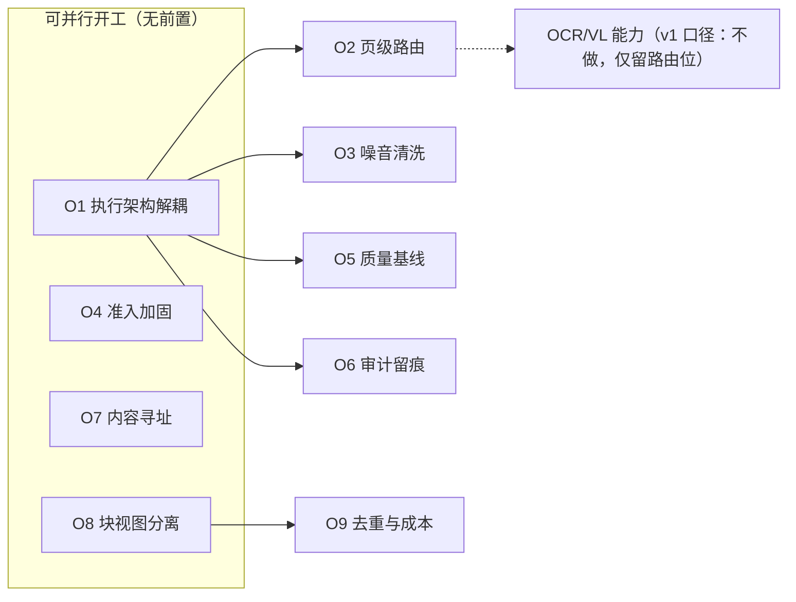

> 状态：🟡 方案待认领 · 建档 2026-09-16 · 未排期（需先登记进 `docs/进度/02-任务清单.md`）

# 优化方案集 —— 入库/解析/分片链路

> 来源：2026-09-16 对 M05 入库链路的专家评审（S4-M05-A / S4-M05-B 交付后的缺口盘点）。
> 与 `plan/*.md` 的区别：那些是**批次开工计划**（有 `T-xxx` 任务行、有验收回填）；本目录是**方案**，
> 只回答「优化什么、为什么、怎么走、怎么验」，**尚未认领到 Sprint**。

---

## 0. 任务追踪表（总表）

| # | 方案 | 主题 | 优先级 | 依赖 | 预估 | 状态 | 落地点 |
|---|---|---|---|---|---|---|---|
| **O1** | [解析执行架构解耦](./O1-parse-worker-decouple.md) | 独立 worker + 超时 + 并发配额 + 任务态持久化 | **P0** | — | 5 人天 | ⬜ 待认领 | `pipeline/` · `AsyncConfig` · `New: V15` |
| **O2** | [页级文本层与多模态路由](./O2-page-level-guard-and-ocr-routing.md) | 检测下沉到页 + OCR/VL 页级路由 | **P0** | O1 | 4 人天 | ⬜ 待认领 | `TextLayerGuard` · `ParsedDocument` |
| **O3** | [噪音清洗层](./O3-noise-cleaning.md) | 页眉页脚剥离 + 装饰图 + 跨文档样板 | **P0** | O1 | 4 人天 | ⬜ 待认领 | `New: pipeline/cleaning` |
| **O4** | [入库准入加固](./O4-ingest-admission-hardening.md) | MIME 交叉校验 + ZIP 炸弹限额 + 恶意扫描 | **P0** | — | 3 人天 | ⬜ 待认领 | `DocStorage#validate` |
| **O5** | [解析质量基线与可追溯](./O5-parse-quality-baseline.md) | 夹具进 CI + 产物版本指纹 + 质量看板 | **P1** | O1 | 3 人天 | ⬜ 待认领 | `New: ParseBaselineTest` |
| **O6** | [审计与合规留痕](./O6-audit-trail-for-pipeline.md) | 解析提交人留痕 + 预签名 TTL | **P1** | O1 | 1.5 人天 | ⬜ 待认领 | `AsyncTaskService` · `AuditLog` |
| **O7** | [存储寻址与生命周期](./O7-content-addressed-storage.md) | 内容寻址（sha256）+ 三前缀留存规则 | **P1** | — | 2 人天 | ⬜ 待认领 | `DocStorage` |
| **O8** | [分片契约：块视图分离](./O8-chunk-view-separation.md) | 块内容与嵌入视图分离 + 多视图泛化 | **P0** | — | 3 人天 | ✅ 已完成（`S4-M05-C1` 步 0 · 2026-09-16） | `10-M05-分片产出契约（D-5）` |
| **O9** | [去重与成本治理](./O9-dedup-and-cost-control.md) | 内容指纹 + 样板抑制 + HyQ 门控 | **P2** | O8 | 3 人天 | ⬜ 待认领 | `T-504`~`T-507` 下游 |

> **2026-09-16 排期裁定**（用户授权「按最优计划开始」后落地，改写了 §2 的原始建议顺序）：
> 本批**不另起 `O1` 批次**，而是把 `O8` 认领为在飞的 **`S4-M05-C1`** 的**步 0**。理由：`O8` 的判据 2/3/5/4
> 都要 `sys_chunk`、表格父子块、向量化才验得了 —— 单独立批只能交付"改契约 + 定枚举"，四条判据全部挂起，
> 而这个仓库已为挂起判据付过对齐成本（`汇总.md` §4、`S3-D` §8.2）。并进 `S4-C1` 则一次验完、不产生新挂账。
>
> **S4-C 拆两半**（工序要求每批 ≤5 个 `T-xxx`，6 个超标；且合计 ~16 人天 > 一个 Sprint 容量）：
> - **`S4-M05-C1`（本批）**：`O8` 步 0 + `T-503` + `T-504` + `T-505` —— **产出侧**，落 `V14`。
> - **`S4-M05-C2`**：`O3`（逐文档清洗，放批首）+ `T-506` + `T-507` + `T-508` —— **索引侧**，`READY` 随它可达。
>
> **`O3` 的窗口订正**：原表只写「`T-508` 之前落地」，但 `O3` 自己的流程图是 `ParsedDocument → 清洗 → 分片输入（T-503）`。
> 订正为：**硬窗 = `T-508` 之前**（向量一旦生成，事后清洗等于全库重建）；**软窗 = `T-503` 之前**（更自然，但清洗是
> `ParsedDocument` 上的**纯函数**，后置只需**重切块**、不需重解析，故放 `C2` 批首也可接受）。**这也是本批不含 `O3` 的理由。**
>
> **`O1` 推后**：它没有数据窗（不改 schema 语义），却是改动面最大的一个（拆 `DocService#upload` 的任务体，
> 会让 `G4-3` 的状态序列夹具重写 —— 而那刚在 S4-B 销账）。在 `T-503`~`T-508` 还在往管线里加阶段时拆 = 同一处改两遍。
> 建议排在 `S4-C` 收口之后。另注：`O1` §4 步 5 里的「`ReentrantLock` → 带超时 `tryLock`」**可独立摘出**，
> 不依赖 worker 与 `sys_async_task`，是 `O1` 里唯一能顺手拿到的收益（**部分**收益：仍会串行，但把"无限挂"变成"有界失败"）。
>
> **`O4` 第二顺位**：唯一不碰管线的 P0（补的是安全闸），与 `S4-C` 不冲突。

> **状态口径**：⬜ 待认领 · 🟡 进行中 · ✅ 已完成 · ⏸️ 挂起（注明等谁）。
> 认领后按 `plan/README.md` 的批次工序另立**批次开工计划**（1~7 节 / 8~10 节回填），本表只维护状态。
>
> ⚠️ **迁移编号冲突**：`V14` 已被 S4-M05-B 预约给 `sys_chunk`（见 `plan/2026-09-16-S4-M05-B.md` §9-1）。
> 本目录所有方案的新迁移**从 `V15` 起**；若 O1/O2 先于 S4-C 落地，需与 `sys_chunk` 那批对齐编号顺序。

> 📐 **流程图**：本文档各方案的第 3 节用 **mermaid 围栏**写业务流程，**不另生成 SVG**
> （IDEA 装了 Mermaid 插件直接渲染；本目录与 `plan/*.md` 的外置 SVG 约定不同，**刻意从简**）。

---

## 1. 为什么有这批方案

S4-M05-A/B 把链路做通了：**文件进得来（UPLOADED）、内容出得来（INDEXING）、出不来时说得出为什么（FAILED + `sys_parse_issue`）**。
评审要回答的是下一个问题：**这条路从 100 篇走到 100 万篇，还成立吗？**

盘点结论按「被咬的先后」排：

| 档 | 缺口 | 一句话 | 方案 |
|---|---|---|---|
| **骨架级** | 解析与在线服务同进程、全局串行、无超时 | 吞吐天花板 + OOM 打穿 API + 一把锁卡死全队列 | **O1** |
| **骨架级** | 「无文本层」是**文档级**判定 | 混合扫描件（38 页文本 + 2 页扫描）静默丢页 —— 正是本项目自定的「最不可接受那类故障」的残留形态 | **O2** |
| **骨架级** | 清洗层空白 | 页眉页脚是**仅次于分片策略的第二大质量变量**，逐页文本还各不相同（页码在变） | **O3** |
| **骨架级** | 准入只有「闸」没有「防」 | `docx/xlsx/pptx` 全是 ZIP 容器，100MB 上限**完全不约束解压后的体积** | **O4** |
| **工程能力** | 没有解析回归基线 | 静默质量事故（"跑起来了但输出变了"）无法发现；依赖升级后不知哪些文档要重解析 | **O5** |
| **合规** | 解析不留痕 | 企业审计必问「谁在何时触发了 X 的解析」 | **O6** |
| **规模** | 存储按 id 寻址 | 同字节文件多份存储；删文档删了什么至今没定 | **O7** |
| **契约** | 块内容与嵌入内容耦合 | 「标题路径注入」被定义成**就地改造内容**，改策略要重解析；表格双表示成了特例而非通用能力 | **O8** |
| **成本** | 去重只到字节级、增强全量跑 | 近似重复（v1/v2、PDF 与其 DOCX 原件）进两份索引；HyQ 逐分片全量调用，占索引侧成本 63% | **O9** |

---

## 2. 依赖关系

> **建议顺序**：`O8`（契约，越早改越便宜）→ `O1`（骨架）→ `O3`（清洗，必须在建向量之前）→ `O4` → `O2` → `O5` → `O6`/`O7` → `O9`。
> **O8 排第一的理由**：它改的是 **D-5 契约**，而 M07（S5）与 `T-503`~`T-505`（S4-C）都在消费它；等到 M07 写完再改是整段返工。

---

## 3. 与既有计划的关系

| 关系 | 说明 |
|---|---|
| **不动** `plan/*.md` | 那些是已完成批次的记录（"计划 → 结果"成对存档），本目录不修改它们，只在认领后新立批次计划。 |
| **交叉** S4-C | `O8` 若采纳，需在 `T-503`（两级分片）开工**之前**改契约；`O3` 需在 `T-508`（向量化）之前落地。 |
| **交叉** S6 | `O2` 的 OCR/VL 路由与 `T-512`/`T-907`（VL 模型，S6）同源 —— 路由位可以先留，能力后接。 |
| **交叉** S7 | `O7` 的生命周期规则与 `T-611`/`T-616`（删除清理）同源。 |
| **不能改** 已跑的迁移 | `V1`~`V13` 一字不动（校验和不符会导致启动失败）；新表新列**从 `V15` 起**。 |

---

## 4. 评审不采纳/降级的项（留痕）

| 建议 | 结论 | 理由 |
|---|---|---|
| 自建 OCR 微服务 | ❌ **不采纳**（保持 v1 口径） | 已有 `OCR_API_*` 占位（`.env.example:90-92`，指向托管 API）；只有「合规要求文档不出内网」才需自托管，且那是**加一个容器**接进 `ModelClientRegistry`，不是微服务。 |
| 解析器换掉 opendataloader | ❌ 不采纳 | 实测够用（`T-0S1` §一-1），真风险在"识别不到时静默返回空"，O2/O5 正面解决它。 |
| 引入 Markdown 全家桶（flexmark 等） | ❌ 不采纳 | 只需**出** markdown，不需要解析它；自研转换器约 150 行（S4-B §5 已定）。 |
| 语义切分（LLM 切块）默认开 | ❌ 不采纳 | `T-503` 已定"仅'无标题且超长'兜底且不可配置"；O8 的视图分离比语义切分更可控。 |
| 先把 `INDEXING → READY` 标上 | ❌ 不再讨论 | `READY` = 唯一可检索状态，无向量不标（S4-B §9-2 已定）。 |
