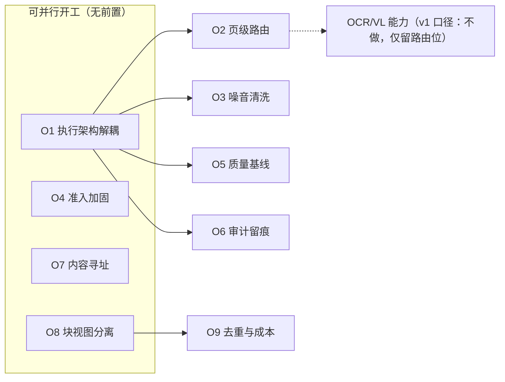

> 状态：🟢 **已登记入册** · 建档 2026-09-16 · 登记 2026-09-17（`T-O01`~`T-O09`，**配额制**）
>
> ⚠️ **建档后 1 天里，本目录的方案在 `02-任务清单.md` / `03-Sprint排期.md` 两份权威文件里零命中** ——
> 没有 `T-xxx` 编号，排期表就看不见它们，每批开工也不会被认领（实际只有 `O8`/`O3` 被批次计划**顺手捞过**）。
> **教训：没有编号 = 不会被排上。** 2026-09-17 补登记，并把「每批固定切 ≥4 人天给 O 项」写进排期表——
> 用户当日明确要求「**不要等全部做完后再来优化，要同时进行**」。

# 优化方案集 —— 入库/解析/分片链路

> 来源：2026-09-16 对 M05 入库链路的专家评审（S4-M05-A / S4-M05-B 交付后的缺口盘点）。
> 与 `plan/*.md` 的区别：那些是**批次开工计划**（有 `T-xxx` 任务行、有验收回填）；本目录是**方案**，
> 只回答「优化什么、为什么、怎么走、怎么验」，**尚未认领到 Sprint**。

---

## 0. 任务追踪表（总表）

| # | ID | 方案 | 主题 | 优先级 | 依赖 | 预估 | 状态 | 落哪批 | 落地点 |
|---|---|---|---|---|---|---|---|---|---|
| **O1** | `T-O01` | [解析执行架构解耦](./O1-parse-worker-decouple.md) | ~~独立 worker~~ → **同 JVM 专用解析池** + 超时 + 并发配额 + 任务态持久化 | **P0** | — | 5 → **实际 ≈7** 人天 | ✅ **已完成**（`S4-E1`，2026-09-17）**降级版**：OOM 隔离与整篇 wall-clock 超时未做（同源限制），登记为遗留 | **`S4-E1`** ✅ | `core/async/{ParseWorker, SysAsyncTaskRepository}` · `New: V17` |
| **O2** | `T-O02` | [页级文本层与多模态路由](./O2-page-level-guard-and-ocr-routing.md) | 检测下沉到页 + OCR/VL 页级路由 | **P0** | O1 ✅ | 4 人天（**含步 0 探针 0.5**） | ✅ **已完成**（`S4-E2`，2026-09-17）—— 6 条判据全通过。⚠️ **探针推翻了本文档 §6 建议的「页级阈值 10」**：实测会让 4 份正常文档里的 **7 个页面**误报（封面 10 字 / PPT 页 11 字 / 截图页 8 字，**都有文本层**），故口径改为**绝对零、无阈值** | **`S4-E2`** ✅ | `TextLayerGuard` · `ParsedDocument` · `V18` · `pipeline/routing/` |
| **O3** | `T-O03` | [噪音清洗层](./O3-noise-cleaning.md) | 页眉页脚剥离 + 装饰图 + 跨文档样板 | **P0** | **O8 ✅**（真实依赖）· O1（软，已推后） | 4 人天 | ✅ **已结项**（页眉页脚 `S4-M05-C2` / **装饰图 `S6-M05-E`，2026-09-19** / 跨文档样板 → `O9` ✅）—— 装饰图：dHash + 跨文档 LSH + **整页守卫（绝对面积上界）** + 不进召回池。⚠️ 三个阈值**没量过**（无正样本语料） | `S4-M05-C2`（页眉页脚）· **`S6-M05-E`（装饰图）** | `pipeline/vision/` + `service/DocRecordWriter` |
| **O4** | `T-O04` | [入库准入加固](./O4-ingest-admission-hardening.md) | MIME 交叉校验 + ZIP 炸弹限额 + 恶意扫描 + 宏标记 | **P0** | — | 3 人天 → **实际 ≈4.5** | ✅ **已完成**（`S4-D` 部分 + **`S6-M09-B` 收尾**，2026-09-18）—— 同步三道（`S4-D`）+ **恶意扫描（手写 `INSTREAM` 客户端 + 异步编排）与宏检测（自研）**（本批）。⚠️ **判据 4 的真容器半边挂起**（`clamav/clamav` 镜像拉不到，registry 不可达）—— 验的是**我方这一半**（协议字节级 + 三态解析 + 命中后的行为），替身走真 TCP / 真异步 / 真落库。🔴 **`O4` 文档说「Tika 可直接给出 `hasMacro`」是错的**（Tika 3.2.2 无任何宏相关 API）⇒ 自研两条路。🔴 **审计新开第 6 类 `SECURITY_EVENT`**（§4.3 那几类的共同点是「人做了什么」，而这个是系统发现的） | **`S4-D`** ✅ + **`S6-M09-B`** ✅ | `core/storage/{IngestGuard, ClamAvScanner}` · `service/{DocScanService, DocScanAuditTrail}` · `V28` |
| **O5** | `T-O05` | [解析质量基线与可追溯](./O5-parse-quality-baseline.md) | 夹具进 CI + 产物版本指纹 + 质量看板 | **P1** | O1 ✅ | 3 人天 | ✅ **已完成**（`S5-M07-B`，2026-09-17）—— **步 1~8 全交 · 判据 1~6 全通过**。⚠️ 判据 2 的**第一版基线抓不到它自己要抓的那个退化**（加 `multiLineCells` 度量后才抓住）；⚠️ 步 6 **只交服务不交 HTTP**（消费方页面属 S8，权限码也不存在）；⚠️ 只占 3 人天 < 配额下限 4（连续第二批） | **`S5-M07-B`** ✅ | `ParseBaselineTest` · `ParseFingerprint` · `ParseQualityService` · `V20`/`V21` |
| **O6** | `T-O06` | [审计与合规留痕](./O6-audit-trail-for-pipeline.md) | 解析提交人留痕 + 预签名 TTL | **P1** | O1 ✅ | 1.5 人天 → **实际更少** | 🟡 **部分已交**（`S4-E2`，2026-09-17）—— 步 1/3 已交付（三条审计点 + 同 traceId + 系统身份）· **步 5/6 已排除**（步 6 由 `T-O07` 交付、步 5 自己建议不做）· **步 4 与判据 3/5 挂起待 `T-614`**。 🟡 **步 4 的可做半边已交**（`S5-M08-C`，2026-09-18）：🔴 **开工时查明它点名的对象不存在** —— 全仓只有三处预签名（头像 7 天 / 审计导出 24h / **问答附件 10 分钟**），**文档下载/预览的预签名后端根本没有**（`DocController` 无 download/preview）。故只交「**口径集中**」（新建 `core/storage/PresignTtl`，三处引用、每处写清"为什么是那个值"，含**为什么不收窄**那两处）+ 附件**出生即短 TTL**（运行时实测 `X-Amz-Expires=600`）。判据 5 的**文档半边挂 `T-614`**。⚠️ 只占 **≈0.5 人天**（**连续第五批低于下限 4**） | **`S4-E2`** ✅ + **`S5-M08-C`** ✅ / 余下 → `T-614` | `ParseAuditTrail` · `AuditAspect` · `AsyncConfig` · `SysAsyncTaskRepository` · **`core/storage/PresignTtl`** |
| **O7** | `T-O07` | [存储寻址与生命周期](./O7-content-addressed-storage.md) | 内容寻址（sha256）+ 三前缀留存规则 | **P1** | — | 2 人天 | ✅ **已完成（降级版）**（`S4-D`，2026-09-17）—— **只做留存规则表**，内容寻址不做（用户裁定：与同批 `T-407` 是同一个设计决定） | `S4-D` | `docs/后端开发文档/11-M05-存储生命周期规则（O7）.md` |
| **O8** | `T-O08` | [分片契约：块视图分离](./O8-chunk-view-separation.md) | 块内容与嵌入视图分离 + 多视图泛化 | **P0** | — | 3 人天 | ✅ 已完成（`S4-M05-C1` 步 0 · 2026-09-16） | `S4-M05-C1` 步 0 | `10-M05-分片产出契约（D-5）` |
| **O9** | `T-O09` | [去重与成本治理](./O9-dedup-and-cost-control.md) | 内容指纹 + 样板抑制 + HyQ 门控 | **P2** | O8 | 3 人天 | ✅ **已结项**（`S5-M08-B`，2026-09-18） | 步 1/2/3/4/7 于 `S5-M07-A` 交 · **步 5（HyQ 门控）/ 步 6（章节级摘要）本批交** | `T-504`~`T-507` 下游；判据 1/2/3/4/7 全通过，**判据 5 只有一半**（调用量已量 · **召回质量 A/B 挂起**，要真模型）· 步 3 的语料级回扫仍顺延 |
| **O10** | `T-O10` | [探针产物兜底](./O10-probe-artifact-fallback.md) | **Java 用例侧的 MinIO 对象兜底**（扫四个前缀的无主对象） | **P0** | — | ≈1.5 人天 | ✅ **已完成**（`S6-M05-C`，2026-09-18）—— `ProbeCleanup#sweepOrphanMinioObjects`（**四前缀一次收口** + **时间下限**防误删）+ 接进 `ApiTestSupport` 收尾 + `OrphanMinioSweepTest` **3 条**（含 **2 条差分式负向锚**）。⚠️ **`audit-export/` 明确不覆盖**（无归属列可判）。✅ **顺带解掉 `#194`**、**覆盖 `#78` 的 `avatars/`**。🔴 **施工中我报错过一次数**（按 `ls` 数行读出"905 个孤儿对象"，用客户端一量是 **0**）—— 教训：**用与删除同一个工具去量**，见方案 §2.5 | **`S6-M05-C`** ✅ | `test/support/ProbeCleanup#sweepOrphanMinioObjects` · `ApiTestSupport` · `OrphanMinioSweepTest` |
| **O11** | `T-O11` | [审计导出兜底](./O11-audit-export-fallback.md) | **`audit-export/` 无主对象兜底** —— 归属在**对象名路径里**（`audit-export/{userId}/…`），不在列里 | **P1** | `T-O10`（沿用其全部纪律：时间下限 / 客户端计数 / `>0` 是信号） | ≈2 人天 | ✅ **已交付**（`2026-09-19-测试可靠性`，2026-09-19） | **`2026-09-19-测试可靠性`** | `test/support/ProbeCleanup`（`MINIO_PREFIXES` 扩成两类归属）· `AuditQueryFlowTest#cleanExportTasks` · `OrphanMinioSweepTest` |
| **O12** | `T-O12` | [登记表机器对账](./O12-ledger-machine-check.md) | **台账侧的机器对账** —— 门禁号 / 计划索引 / 批次账**三组事实互比，只报不改** | **P1** | — | ≈2 人天（**实际 ≈2**） | ✅ **已交付**（`2026-09-19-S6-M11`，2026-09-19） | **`2026-09-19-S6-M11`** | `scripts/check-ledgers.mjs`（L1 门禁号 / L2 计划索引 / L3 批次账 + 退出码 `0/1/2` 分档，**只报不改**）。✅ **判据 1~4 全过**；🔴 **它第一天就抓出两件事**：`S6-M09-B` 把 10 行自定判据编成了门禁号（**方案 §5.1**）+ **本批计划自己的 3 行同类错误**。⚠️ 规则是**四轮收敛**出来的（140 → 52 → 13 → 9 条），**已知漏报**写在方案 §5.1 |
| **O13** | `T-O13` | （本批新建，方案随交付落地） | **排序规则收敛** —— 全仓**两套 collation**（实查 18 张 `utf8mb4_0900_ai_ci` vs 10 张 `utf8mb4_unicode_ci`），跨表比字符串报 `1267` | **P0**（地雷：越晚越贵） | — | ≈2 人天 | ✅ **已交付**（`2026-09-20-S8-M10-A`，2026-09-20）—— `V33`：9 张表 `CONVERT` + **`ALTER DATABASE` 改库默认** + `docker-compose.yml:50`。🔴 **根因不在表上**：服务端默认与一部分迁移里显式写的 `COLLATE` 不一致 ⇒ **只 `ALTER TABLE` 不够**（下次建表又落回旧的那套）。`CollationUniformityTest` 4 条（全库一致 / 库默认 / **豁免冻结** / 跨表比较）。**证伪**：把一张表转回去 ⇒ 闸点名 **且**跨表比较报 1267（与 `S6-M11` 那次同一个错误码） | **`2026-09-20-S8-M10-A`** ✅ | `V33__collation_converge.sql` · `CollationUniformityTest` · `docker-compose.yml` |
| **O14** | `T-O14` | （源 `#190`；**核实后发现无需方案**） | **Java 侧 MinIO 兜底** | P2 | — | ≈1.5 → **实际 0** | ✅ **核实即销**（`2026-09-20-S8-M10-A`，2026-09-20）—— 它要的能力**早在 `T-O10` 交付**（`ProbeCleanup.MINIO_PREFIXES` 6 前缀 + 逐前缀归属规则 + 接进 `ApiTestSupport`），`OrphanMinioSweepTest` **6/6**（判据 6 断言"六前缀逐个表态"）。⚠️ **它与 `T-O10` 同一天登记与交付，却没人回头销账** ⇒ 以"下一批优先"的姿态在账上躺了三天 | **`2026-09-20-S8-M10-A`** ✅ | `test/support/ProbeCleanup#MINIO_PREFIXES` · `OrphanMinioSweepTest` |
| **O15** | `T-O15` | （本批新建，方案随交付落地） | **覆盖率闸：换个列名也躲不开** —— 旧闸只认**精确列名**（`user_id`/`kb_id`/`doc_id`） | **P1** | — | ≈0.4 人天 | ✅ **已交付**（`2026-09-20-S8-M10-A`，2026-09-20）—— 扫描改成**包含匹配**（`%user_id%` 等）并冻结模式（两侧：`probe-teardown.mjs` 的 `SCOPE_PATTERNS` ↔ `ProbeArtifactCoverageTest`）。由来：`sys_qa_miss` 的归属列**真的需要**叫 `last_user_id`（聚合行，叫 `user_id` 是用名字撒谎），而旧闸**看不见**它 ⇒ 只能靠手工登记，正是 `V31` 头注警告的"换个名字躲开闸"。**证伪**：把登记项改名 ⇒ 闸当场点名 `sys_qa_miss` | **`2026-09-20-S8-M10-A`** ✅ | `scripts/lib/probe-teardown.mjs` · `ProbeArtifactCoverageTest` · `ProbeArtifacts` |
| **O16** | `T-O16` | （源 `#225`；**核实后判定"后端本来就是单一事实源"**） | **嵌入模型信息的单一事实源** —— 同一个四字段结构在 `api/index.ts` 内联两遍、在两个视图里**各自又写一份初值**（`{ model: 'BAAI/bge-m3', dimension: 1024, ... }`） | **P2** | — | ≈1 人天 | ✅ **已交付**（`2026-09-20-S8-M10-B`，2026-09-20）—— 🔴 **核实推翻了登记时的描述**：后端**本来就是**单一事实源（模型名取注册中心、维度与度量取 `MilvusConstants`）⇒ **真问题是前端那份"猜的初值"**：页面在 `/kb/presets` 回来之前、以及**它失败的时候**显示的就是它，而它长得和真值一模一样（`#85` 族的陷阱）。处置：初值改 `null` ⇒ 那时显示 `—`（与同文件 `vlModel` 的 `'—'` 同口径）；`EmbeddingInfo` 提成命名类型、`api/index.ts` 的两处内联改用它；`MilvusConstants.DIMENSION` 补口径说明（它是**集合的维度**，不是"模型自报的维度"）。**判据**：`grep -rn` 在 `ai_knowledge_app/src/views/kb/` 下搜 `1024` 或 `bge-m3` → **0 行** | **`2026-09-20-S8-M10-B`** ✅ | `types/index.ts`（`EmbeddingInfo`）· `api/index.ts` · `KbCreateView.vue` / `KbDetailView.vue` · `MilvusConstants` |
| **O17** | `T-O17` | （门禁账，无方案） | **`G6-6`（费用三态）按号取证** —— 它是 `S6` **唯一没按号取证过**的门禁（原批次把这个号写成了「VL 一次两产出」） | P1 | — | ≈1 → **实际 0.3** | ✅ **核实即销**（`2026-09-20-S8-M10-B`，2026-09-20）—— 🔴 **取证早就在位**，缺的只是"按门禁号记一笔"：后端 `ModelUsageFlowTest` 四条已覆盖三态（已配单价 `¥10.00` / `NONE` = **`0` 而不是 `null`** / 未配单价 = **`null` 而不是 `0`**）、`unpricedCount` **不含 `NONE`**、空表是诚实的空态、平均延迟只按有耗时的行算。本批**补上前端那一半**：`routes.mjs` 里 `/system/model` 的 `expect` 加三个前瞻（已计价有金额 / `NONE` 显示不计费 / 未配单价显示 `—`）。⚠️ 那条正则**必须以 `^` 锚定**（四个回头扫描的前瞻不锚定是 O(n²)，实测几十秒一次）。**已逐条证伪**（抹掉任一即转红） | **`2026-09-20-S8-M10-B`** ✅ | `ModelUsageFlowTest`（既有）· `scripts/lib/routes.mjs` · `scripts/render-check.mjs` |
| **O18** | `T-O18` | （闸账，方案随交付落地） | **`check-ledgers` 剩的 3 条 `S3-D` 同名不同义** —— 逐条判定：订正还是接受 | **P2** | — | ≈1.2 人天 | ✅ **已交付**（`2026-09-20-S8-M10-B`，2026-09-20）—— 判定 = **接受**：那三条是**同一个门禁的另一个侧面**（`G3-3` = 前半/字段集同源/后半；`G3-8` = 口径侧/运行时侧面），不是错号。🔴 **但"判完了没地方记"** ⇒ 每批开工都会再报一遍，而"一条永远在报的闸会被忽略"。⇒ 给脚本加了**第二个、更窄的**判定口「`门禁号旁注：G3-3 / G3-8`」：必须**点名**门禁号、只在该文件内生效、只降级"同名不同义"一类（引用了不存在的号**照报**）。**证伪**：只点名 `G3-3` ⇒ `G3-8` 那两条照报（exit 1） | **`2026-09-20-S8-M10-B`** ✅ | `scripts/check-ledgers.mjs` · `plan/2026-09-16-S3-D.md` 的旁注块 |

> 🔴 **2026-09-18 · `S6-M09-A` 未认领 O 项**（用户裁定）—— **连续第六批低于下限 4**。
> 该批 4 个功能任务已写满，且剩下的候选**各自的依赖都还没到**：
> `T-O03` 装饰图判定挂在 `T-512`（依赖 `T-907`）· `T-O04` 余下两项要引 ClamAV 容器 ·
> `T-O06` 步 4 的文档半边**对象不存在**（挂 `T-614`）· `T-O09` 步 3 的语料级回扫要真实语料。
>
> 🔴 **2026-09-18 · `S6-M05-C` 认领两件，但⚠️ 两件都还没做**（**连续第七批配额落在下限之下**）：
> ① **`T-O09` 判据 5** —— HyQ 门控的召回质量**真模型 A/B**（销 `#152`，≈2 人天）；
> ② **补探那 2 份从未进过装饰图探针的 PDF**（`2-提示词工程` 57 图 / `健康生活方式` 15 图，≈0.5~1 天）
> —— ⚠️ **它不算 O 项交付**（不改业务代码），只是收窄 `T-O03` 的判据边界。
> ⇒ **真正算 O 交付的只有 2 人天**。
>
> ⚠️ **该批的实际走向值得记一笔**：用户看到"配额连续低于下限"后裁定
> **"先不推进度，看看哪些遗留的能现做的现做"** —— 结果是该批**大部分工时花在了遗留清理上**
> （7 项：`#186`/`#187`/`#163`/`#149` + B 组顺一遍 + `#85`，外加一个**计划外追出的真 P0**）。
> 那些**不是 O 项**（不在本目录的任何 `T-Oxx` 下），但性质相同：**"越晚做越贵"的基础设施债**。
> ⇒ **给排期的一条建议**：`O` 配额这个口径**只统计本目录登记过的方案**，
> 而"测试/清理基础设施"这一类**从来不在它的统计范围里** —— 于是
> "连续七批低于下限"这个数字，**低估了这个项目实际花在优化上的工时**。
>
> ✅ **2026-09-18 用户裁定：同意收进 O 目录。** 落地为 **`T-O10`「探针产物兜底」**
> （源：`#190` + `#194`，方案见 `O10-probe-artifact-fallback.md`）——
> ⇒ **这一类从此有编号、有方案、能进配额账**。
> ⚠️ **只收了这一项，不是全收**：`#186`/`#187`/`#163`/`#149` 那四项**已经做完了**
> （它们是在"没有 O 项身份"时做的），所以本项**不代表它们被追溯认领**。
> **真正要改的是"以后"**：下次遇到同类基础设施债，**先登记成 `T-Oxx` 再动手**，
> 而不是做完之后留一句"这不算 O 项"。
>
> ⚠️ **本表的 `P0/P1/P2` 与 `02-需求总览与分档.md` §3 那条铁律不是同一根轴** —— 这里是「评审认为多该补」，
> 那里是「缺了核心业务跑不通」。**别拿「O1 = P0」去卡 `S6` 开工**（详见 `02-任务清单.md` §任务总览的警告）。

> **2026-09-17 排期裁定 · 配额制**（用户要求「**不要等全部做完后再来优化，要同时进行**」后落地）：
>
> **根因**：本目录建档时写了「未排期（需先登记进 `docs/进度/02-任务清单.md`）」，**而这一步没人做**。
> 没有 `T-xxx` → `02`/`03` 两份权威文件零命中 → 排期表看不见 → 每批开工也不认领。
> 结果为：建档后 `S4-A`/`B`/`C1`/`C2`/`C3` **五个批次里，只有 `O8`/`O3` 落了地，且都是批次计划顺手捞的**。
>
> **修法两件**：
> 1. **补登记**：`O1`~`O9` → **`T-O01`~`T-O09`**，写进 `02-任务清单.md`（新增「O 优化项」段 + 认领表）。
> 2. **定配额**：从 `S4-D` 起，**每批固定切 ≥4 人天给 O 项**，与功能批并行、独立分支与提交、**不占门禁验收窗**。
>    排期表新增 **O 配额列**（`03-Sprint排期.md` §优化配额）。
>
> **三处被这次盘点推翻/订正的东西**：
> ① **`O1` 的推后理由已失效** —— 原话是「在 `T-503`~`T-508` 还在往管线里加阶段时拆 = 同一处改两遍」，
>    而 C1/C2/C3 已全部收口、`T-508` 已落地。**依赖条件消失，但「推后」这个结论留在了原地**（无人回头改）。
>    连带 `03-Sprint排期.md` 里「吞吐优化放 `S9`」那行也一并订正为指向 `T-O01`。
> ② **逮到一个就在下一批的硬窗**：`T-O07` ↔ `T-407` 是**同一个设计决定**（删库到底删什么 / 内容寻址 + 留存规则）。
>    `S4-D` 先做 `T-407` = 同一处设计做两遍 —— 正是 `O1` 当初被推后的那条理由，**原样复现**。故 `T-O07` 并进 `S4-D`。
> ③ **优先级标签撞车**：本表用的 `P0/P1/P2` 与 `02-需求总览与分档.md` §3「**P0 未完成前不进入 P1 开发**」
>    **同名不同义**。不写清，下一步就会有人拿「`O1` = P0」去卡 `S6` 开工。已在两份文件各加警告。
>
> **2026-09-17 用户再裁定 · 「尽早做」**（原话：「**不用管人数，能尽早做就尽早做，避免后期大改动**」）：
> 上一条裁定把 O 项分散到 `S4-D`~`S9` 五批，用户否掉了这个分散法，**改为一律前置**。
>
> **排序依据随之改成「硬窗 > 改动面 > 依赖」** —— **「改动面」排在依赖前面**：
> 一个改动被越多代码依赖，做晚了返工面越大，而返工面正是要避免的「后期大改动」。
> 于是三项**动别人地基**的一律提前：`T-O04` 从 `S5` → **`S4-D`**（与 `T-O07` 同改 `DocStorage`，一次改完）；
> `T-O01`/`T-O02`/`T-O06` 组成**纯优化批 `S4-E`**（10.5 人天，插在 `S4-D` 与 `S5` 之间）；
> `T-O05`/`T-O09` 从 `S7`/`S9` → **`S5` 并行轨**。**`S6`~`S9` 不再挂 O 项。**
>
> `T-O02` 的提前还叠了一条**时序硬约束**：**`S5` 要建评测集 `T-711` 与质量阈值，
> 基线必须建在修好后的管线上**，否则评测集要重建 —— 这是「早做」不只是省事、而是非做不可的一处。
>
> **代价明说**：O 项合计 **21.5 人天**，而本排期按 **1 人**计（2 周 = 10 人天）。**「并行轨」不产生额外工时** ——
> 每批切给 O 的人天**就是从该批功能容量里拿走的**。故**总量 102 → 123.5 人天**：
> 新增的 `S4-E` 让 **`S5` 起全部后移 2 周，`M1` 里程碑随之后移**（日历已重排，`S9` 落到 2027-02）。
> 用户已知悉并选择接受 —— **这是原排期从未把优化算进去的账，现在补上。**

> **2026-09-16 排期裁定**（用户授权「按最优计划开始」后落地，改写了 §2 的原始建议顺序）：
> 本批**不另起 `O1` 批次**，而是把 `O8` 认领为在飞的 **`S4-M05-C1`** 的**步 0**。理由：`O8` 的判据 2/3/5/4
> 都要 `sys_chunk`、表格父子块、向量化才验得了 —— 单独立批只能交付"改契约 + 定枚举"，四条判据全部挂起，
> 而这个仓库已为挂起判据付过对齐成本（`汇总.md` §4、`S3-D` §8.2）。并进 `S4-C1` 则一次验完、不产生新挂账。
>
> **S4-C 拆两半**（工序要求每批 ≤5 个 `T-xxx`，6 个超标；且合计 ~16 人天 > 一个 Sprint 容量）：
> - **`S4-M05-C1`（本批）**：`O8` 步 0 + `T-503` + `T-504` + `T-505` —— **产出侧**，落 `V14`。
> - **`S4-M05-C2`**：`O3`（逐文档清洗，放批首）+ `T-506` + `T-507` + `T-508` —— **索引侧**，`READY` 随它可达。
>
> **`O3` 的窗口订正**：原表只写「`T-508` 之前落地」，但 `O3` 自己的流程图是 `ParsedDocument → 清洗 → 分片输入（T-503）`。
> 订正为：**硬窗 = `T-508` 之前**（向量一旦生成，事后清洗等于全库重建）；**软窗 = `T-503` 之前**（更自然，但清洗是
> `ParsedDocument` 上的**纯函数**，后置只需**重切块**、不需重解析，故放 `C2` 批首也可接受）。**这也是本批不含 `O3` 的理由。**
>
> **2026-09-16 追加 · `S4-C` 拆成三批**（`S4-C2` 立据时）：C1（产出侧，已完成）→ **C2 = `O3` + `T-506` + `T-507`**
> （索引前的内容准备，~10 人天）→ **C3 = `T-508` 向量化**（~3 人天，`READY` 随它可达）。
> 拆点选在 `T-508` 之前的理由：`O3` 的硬窗是「建向量之前」，而 `T-507` 的产物（`SUMMARY`/HyQ 块）
> **也是要被向量化的内容** —— 放前面，C3 就能**一次性**把所有块送进 Milvus，不必"先索引一遍、加了摘要再重建一遍"。
>
> **`O3` 的真实依赖订正**：原表把 `O1` 列为依赖，但那是**排序偏好**（"先做骨架再往里放东西"），不是技术前置。
> `O3` §6 风险段自己写的对策是「**`O8` 的父子块 + 回表**」—— `O8` 已在 C1 交付 ✅。
> 清洗是对 `ParsedDocument` 的纯函数变换，`O1` 把解析搬进独立 worker **不会让它白写**。
>
> **2026-09-16 追加 · `S4-C2` 交付时的两处范围收窄**（都由开工探针逼出来，详见 `2026-09-16-S4-M05-C2.md` §3.5）：
> ① **装饰图判定挂 S6**（与 `T-512` 合并）。`O3` §4 步 3 的三条件里，pHash 需要图像字节而解析产物
> **只有元素存在性**（本批拿不到）；而"尺寸/位置固定"的两个输入**也不在产物里**（`image` 元素确实带
> `bounding box`，但 `DocElement.image` 只存页号 —— `README` 与本文件此前都写"已有"，是错的）。
> 更关键的是它**没有硬窗**：`O3` 对清洗的硬要求是"建向量之前"，而图片本批**不进索引**
> （`IMAGE` 块等 `T-512`）。干跑实测三份真样本**没有一份含跨页同位置的图** → 正向证据只能靠合成。
> ② **判据 1 的样本前提是假的**：`O3` §5 点名 `江西省…项目管理章程.pdf` 为"带页眉页脚的 PDF"，
> 实测它是 **PPT 导出**（`Author: zhuangx` / `Title: PowerPoint 演示文稿`），
> 页脚只有一个孤零零的页码、且只出现在 6 张章节隔页上（20 页里占 4 页 = 20%，够不到 60%）。
> **所以本批的正向证据是合成的，反向证据才是真的**（三份真样本一处不剥、`chars` 一字不减）。
> 这条不对称写进了 `DocumentCleanerTest` 的类 javadoc —— 下一个改清洗的人必须先读到它。
>
> **`O3` 的跨文档样板抑制移出本批**（→ `O9`）：它是**语料级**的（要看到多个文档才知道什么重复），
> 且 `O9` §3 的 ③ 就是同一件事 —— 放两处等于做两遍。

> **`O1` 推后**：它没有数据窗（不改 schema 语义），却是改动面最大的一个（拆 `DocService#upload` 的任务体，
> 会让 `G4-3` 的状态序列夹具重写 —— 而那刚在 S4-B 销账）。在 `T-503`~`T-508` 还在往管线里加阶段时拆 = 同一处改两遍。
> 建议排在 `S4-C` 收口之后。另注：`O1` §4 步 5 里的「`ReentrantLock` → 带超时 `tryLock`」**可独立摘出**，
> 不依赖 worker 与 `sys_async_task`，是 `O1` 里唯一能顺手拿到的收益（**部分**收益：仍会串行，但把"无限挂"变成"有界失败"）。
>
> **`O4` 第二顺位**：唯一不碰管线的 P0（补的是安全闸），与 `S4-C` 不冲突。

> ⚠️ **`O4` 的归属订正（2026-09-17 · `S4-E2` 结项时查出）**：它原先写「恶意扫描随 `T-O01`（`S4-E`）落地」，
> 而 `S4-E1`/`S4-E2` 两批**都没做它** —— 理由是 `S4-E1` §3.3：ClamAV **要新增第 7 个容器**，
> 与调度/页级路由均无技术耦合，容器选型应由用户拍板。**它现在没有归属批次**（`S4-E` 已结项）。
> 同上，`O4` 的「宏标记」需新列 + 前端，仍未认领。

> **状态口径**：⬜ 待认领 · 🟡 进行中 · ✅ 已完成 · ⏸️ 挂起（注明等谁）。
> 认领后按 `plan/README.md` 的批次工序另立**批次开工计划**（1~7 节 / 8~10 节回填），本表只维护状态。
>
> ⚠️ **迁移编号冲突**：`V14` 已被 S4-M05-B 预约给 `sys_chunk`（见 `plan/2026-09-16-S4-M05-B.md` §9-1）。
> 本目录所有方案的新迁移**从 `V15` 起**；若 O1/O2 先于 S4-C 落地，需与 `sys_chunk` 那批对齐编号顺序。

> 📐 **流程图**：本文档各方案的第 3 节用 **mermaid 围栏**写业务流程，**不另生成 SVG**
> （IDEA 装了 Mermaid 插件直接渲染；本目录与 `plan/*.md` 的外置 SVG 约定不同，**刻意从简**）。

---

## 1. 为什么有这批方案

S4-M05-A/B 把链路做通了：**文件进得来（UPLOADED）、内容出得来（INDEXING）、出不来时说得出为什么（FAILED + `sys_parse_issue`）**。
评审要回答的是下一个问题：**这条路从 100 篇走到 100 万篇，还成立吗？**

盘点结论按「被咬的先后」排：

| 档 | 缺口 | 一句话 | 方案 |
|---|---|---|---|
| **骨架级** | 解析与在线服务同进程、全局串行、无超时 | 吞吐天花板 + OOM 打穿 API + 一把锁卡死全队列 | **O1** |
| **骨架级** | 「无文本层」是**文档级**判定 | 混合扫描件（38 页文本 + 2 页扫描）静默丢页 —— 正是本项目自定的「最不可接受那类故障」的残留形态 | **O2** |
| **骨架级** | 清洗层空白 | 页眉页脚是**仅次于分片策略的第二大质量变量**，逐页文本还各不相同（页码在变） | **O3** |
| **骨架级** | 准入只有「闸」没有「防」 | `docx/xlsx/pptx` 全是 ZIP 容器，100MB 上限**完全不约束解压后的体积** | **O4** |
| **工程能力** | 没有解析回归基线 | 静默质量事故（"跑起来了但输出变了"）无法发现；依赖升级后不知哪些文档要重解析 | **O5** |
| **合规** | 解析不留痕 | 企业审计必问「谁在何时触发了 X 的解析」 | **O6** |
| **规模** | 存储按 id 寻址 | 同字节文件多份存储；删文档删了什么至今没定 | **O7** |
| **契约** | 块内容与嵌入内容耦合 | 「标题路径注入」被定义成**就地改造内容**，改策略要重解析；表格双表示成了特例而非通用能力 | **O8** |
| **成本** | 去重只到字节级、增强全量跑 | 近似重复（v1/v2、PDF 与其 DOCX 原件）进两份索引；HyQ 逐分片全量调用，占索引侧成本 63% | **O9** |

---

## 2. 依赖关系

> **建议顺序**：`O8`（契约，越早改越便宜）→ `O1`（骨架）→ `O3`（清洗，必须在建向量之前）→ `O4` → `O2` → `O5` → `O6`/`O7` → `O9`。
> **O8 排第一的理由**：它改的是 **D-5 契约**，而 M07（S5）与 `T-503`~`T-505`（S4-C）都在消费它；等到 M07 写完再改是整段返工。

---

## 3. 与既有计划的关系

| 关系 | 说明 |
|---|---|
| **不动** `plan/*.md` | 那些是已完成批次的记录（"计划 → 结果"成对存档），本目录不修改它们，只在认领后新立批次计划。 |
| **交叉** S4-C | `O8` 若采纳，需在 `T-503`（两级分片）开工**之前**改契约；`O3` 需在 `T-508`（向量化）之前落地。 |
| **交叉** S6 | `O2` 的 OCR/VL 路由与 `T-512`/`T-907`（VL 模型，S6）同源 —— 路由位可以先留，能力后接。 |
| **交叉** S7 | `O7` 的生命周期规则与 `T-611`/`T-616`（删除清理）同源。 |
| **不能改** 已跑的迁移 | `V1`~`V13` 一字不动（校验和不符会导致启动失败）；新表新列**从 `V15` 起**。 |

---

## 4. 评审不采纳/降级的项（留痕）

| 建议 | 结论 | 理由 |
|---|---|---|
| 自建 OCR 微服务 | ❌ **不采纳**（保持 v1 口径） | 已有 `OCR_API_*` 占位（`.env.example:90-92`，指向托管 API）；只有「合规要求文档不出内网」才需自托管，且那是**加一个容器**接进 `ModelClientRegistry`，不是微服务。 |
| 解析器换掉 opendataloader | ❌ 不采纳 | 实测够用（`T-0S1` §一-1），真风险在"识别不到时静默返回空"，O2/O5 正面解决它。 |
| 引入 Markdown 全家桶（flexmark 等） | ❌ 不采纳 | 只需**出** markdown，不需要解析它；自研转换器约 150 行（S4-B §5 已定）。 |
| 语义切分（LLM 切块）默认开 | ❌ 不采纳 | `T-503` 已定"仅'无标题且超长'兜底且不可配置"；O8 的视图分离比语义切分更可控。 |
| 先把 `INDEXING → READY` 标上 | ❌ 不再讨论 | `READY` = 唯一可检索状态，无向量不标（S4-B §9-2 已定）。 |

> 🔴 **2026-09-19 · `S6-M09-C` 未认领 O 项 —— 但这次的成因与前十批都不同**（**连续第十一批低于下限 4**）：
> 逐条核过本表 —— **`T-O01`~`T-O10` 十项全部结项**，余下部分**全卡在外部条件**：
> `T-O03` 三个阈值要**正样本语料**（已核实仓里 5 份 PDF 互不相关，造不出同源语料）·
> `T-O04` 判据 4 要 ClamAV 镜像（拉不到）· `T-O06` 步 4/判据 3·5 要 `T-614` ·
> `T-O09` 步 3 要真实语料。
> ⇒ **账上真的空了** —— 不是"没做完"（`S6-M05-C`）· 不是"前提塌了"（`S6-M05-D`）·
> 不是"该做的比估的少"（`S6-M05-E`），而是**目录里已经没有"现在能做且值得做"的项**。
>
> 🔴 **建议登记 `T-O11`「`audit-export/` 产物兜底」**（源：`S6-M09-C` §9-**228**）：
> 实测该前缀有 **137 个真对象**（Sep 15~19 每天都有）、**没有任何清理入口**，
> 而 `mvn test` **每轮都往里写**（`AuditQueryFlowTest` 真调 `POST /api/audit/export`，
> 而 `ProbeCleanup` 明确不覆盖它 —— `#78`：导出没有归属列可判）。
> ⚠️ 这句话现在不成立：**「五前缀真对象 0」是对的但不完整** —— 清理清单是个**白名单**，
> 白名单外的产物**没人管而闸照样绿**（「闸说干净 ≠ 真的干净」的又一次变形）。
> 🔴 **它正属用户 2026-09-18 裁定要收进 O 目录的那一类**（"测试/清理基础设施"）。
> **按那条裁定：先有编号再动手** —— 所以本批只登记候选，不动手。
